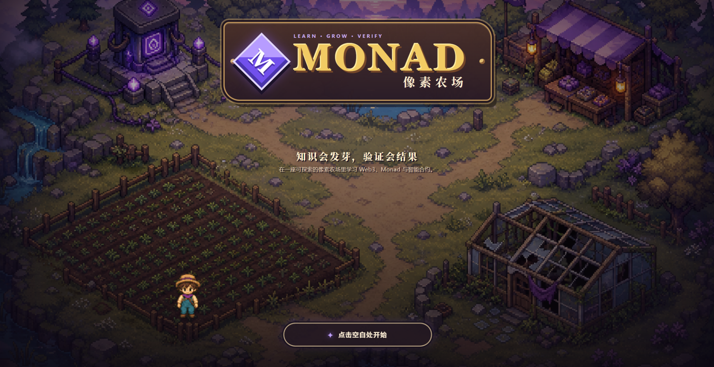
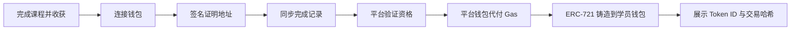

<p align="center">
  
</p>

<h1 align="center">Monad 像素农场</h1>

<p align="center">
  <strong>Learn · Grow · Verify</strong><br />
  把抽象的 Web3 知识，种成看得见、能验证、可带走的成长。
</p>

<p align="center">
  <a href="https://monad-pixel-farm.sushengi.workers.dev">在线体验</a>
  ·
  <a href="https://testnet.monadscan.com/address/0xc96a7087cfbbe5eb6f6f81a0905ad7a4d1375a5f">徽章合约</a>
  ·
  <a href="./docs/Monad像素农场_PRD_v3.5.md">产品文档</a>
</p>

## 项目背景

Web3 的第一道门槛往往不是操作，而是理解：钱包、Gas、交易确认、区块浏览器、智能合约和链上凭证彼此关联，却通常被拆散在文档、教程和工具中。新用户记住了概念，也未必建立了完整的行动路径。

Monad 像素农场希望把这条学习路径变成一段可以探索的旅程。

在这里，一门课程是一块土地，一颗种子是一条知识主线。玩家需要亲手开荒、播种、学习、挑战、验证和收获。抽象的进度会变成土地与作物的真实变化；当课程完成后，玩家可以连接钱包、签名证明地址，由平台验证完成记录并代付 Gas，将不可转让的 ERC-721 学习徽章铸造到学员钱包。

> **知识会发芽，验证会结果。**

## 我们能为 Monad 带来什么

### 1. 更自然的新用户入口

把 Monad、EVM、交易确认和智能合约知识放进可探索的像素农场，用任务、地图和作物成长降低第一次接触区块链的理解成本。

### 2. 从“看过教程”走向“真正使用网络”

学习者不仅阅读内容，还会连接钱包、切换 Monad Testnet、签名证明地址、查看交易状态和使用区块浏览器。钓鱼玩法支持真实测试网交易，课程完成后则会触发真实的 ERC-721 徽章铸造。

### 3. 为生态建立可验证的学习凭证

课程完成记录先由平台验证，再与学员签名的钱包地址绑定。最终颁发的 Soulbound ERC-721 徽章不可转让，更适合表达“这个地址完成过什么学习”，而不是可以交易的普通道具。

### 4. 把教育转化为开发者成长漏斗

农场可以继续扩展更多课程格、生态项目任务、开发挑战和活动徽章，为 Monad 项目方提供从认知、体验、实践到身份沉淀的一体化入口。

## 我们能为 Web3 带来什么

- **更低的学习压力**：用种田、探索和收获替代连续的术语灌输。
- **更清晰的成长反馈**：未开荒、播种、发芽、开花、结果和收获分别对应真实学习节点。
- **更安全的首次链上体验**：钱包签名只用于证明接收地址；徽章由平台钱包代付 Gas，避免新用户因余额不足中断学习。
- **更可信的学习成果**：平台验证课程完成状态，链上徽章记录最终成果，并提供 Token ID、交易哈希和浏览器链接。
- **可复用的课程容器**：九格课程田可以承载 Web3 基础、Monad、智能合约以及未来的生态协议课程。

## 核心体验

| 模块 | 当前能力 |
| --- | --- |
| 全屏农场探索 | WASD、方向键、点击寻路、碰撞、镜头跟随和地点交互 |
| 九格课程田 | 一格一课程、一课一种子，按顺序解锁与成长 |
| 三门首发课程 | Web3 通识、Monad 基础、智能合约 |
| 动态种植反馈 | 开荒、播种、发芽、开花、结果、收获七阶段 |
| 回执池塘 | 普通练习与 Monad Testnet 真实交易，10 种鱼类图鉴 |
| 成长档案 | EXP、课程果实、种子、完成状态与三类 NFT 徽章 |
| 链上学习徽章 | 钱包签名、平台验证、Gas 代付、ERC-721 铸造与链上凭证展示 |

## NFT 领取流程



当前徽章合约部署于 **Monad Testnet（Chain ID 10143）**：

[`0xc96a7087cfbbe5eb6f6f81a0905ad7a4d1375a5f`](https://testnet.monadscan.com/address/0xc96a7087cfbbe5eb6f6f81a0905ad7a4d1375a5f)

| Type ID | 课程 | 徽章 |
| ---: | --- | --- |
| 0 | Web3 通识 | 账本守护者 |
| 1 | Monad 基础 | Monad 探索者 |
| 2 | 智能合约 | 合约建造师 |

> 当前部署面向 Monad Testnet。课程徽章为不可转让 ERC-721，用于记录学习成果，不代表金融资产或收益承诺。

## 技术架构

- **前端**：Next.js 16、React 19、DOM/CSS 像素场景
- **Cloudflare 运行时**：Vinext、Workers、Static Assets
- **数据库**：Cloudflare D1、Drizzle ORM
- **链交互**：Viem、Monad Testnet
- **智能合约**：Solidity 0.8.28、OpenZeppelin ERC-721、Foundry
- **寻路与场景**：24px 导航网格、A*、`requestAnimationFrame`

## 快速开始

环境要求：Node.js `>=22.13.0`。

```bash
npm ci
npx wrangler d1 execute monad-pixel-farm-db --local --file=scripts/init-d1.sql
npm run dev
```

默认访问地址为 `http://localhost:3000`。

### 本地链上配置

复制环境变量模板：

```bash
cp .dev.vars.example .dev.vars
```

| 变量 | 用途 |
| --- | --- |
| `MONAD_RPC_URL` | Monad Testnet RPC |
| `BADGE_CONTRACT_ADDRESS` | 课程徽章合约地址 |
| `MINTER_PRIVATE_KEY` | 平台铸造钱包私钥，仅服务端使用 |

请勿提交 `.dev.vars`、`.env` 或任何真实私钥。

## 验证与构建

```bash
npm run lint
npm test
npm run contract:compile
```

`npm test` 会先进行生产构建，再执行状态机、探索交互、课程成长、钓鱼和后端数据流程测试。

## 部署

### Cloudflare Workers

```bash
npm run build
npx wrangler deploy
```

正式环境中的铸造私钥应使用 Cloudflare Secret：

```bash
npx wrangler secret put MINTER_PRIVATE_KEY
```

### 部署新的测试网徽章合约

```bash
npm run contract:deploy:testnet
```

部署脚本会创建合约、初始化三类徽章，并为平台钱包开启 minter 权限。

## 项目结构

```text
├── app/
│   ├── api/                    # 钱包挑战、进度、资格和 NFT 铸造接口
│   └── game/                   # 农场世界、课程、钓鱼与领取界面
├── db/                         # D1 / Drizzle 数据结构
├── drizzle/                    # 远端数据库增量迁移
├── lib/                        # 认证、进度、链交互和数据访问层
├── onchain/
│   ├── contracts/NFTBadge.sol # Soulbound ERC-721 徽章合约
│   └── test/                   # Foundry 合约测试
├── public/art/                 # 地图、角色、作物、鱼类和徽章素材
├── scripts/                    # D1、合约编译与部署脚本
├── tests/                      # 状态机、交互与渲染测试
└── wrangler.jsonc              # Cloudflare Workers 配置
```

## 当前边界与下一步

当前版本已经完成三门课程、九格田前三区域、钱包连接、钓鱼上链和课程徽章铸造。学习过程保存在浏览器本地；领取徽章时，完成状态会在钱包签名后同步至 D1，由平台验证并发起链上铸造。

后续方向包括：

- 将更多学习事件沉淀为可跨平台验证的证明；
- 为 Monad 生态项目开放课程格和联合任务；
- 扩展课程徽章、活动徽章与开发者成就体系；
- 引入 Agent 动态验证和更完整的学习分析。

## 文档

- [产品需求文档 v3.5](./docs/Monad像素农场_PRD_v3.5.md)
- [前端交互说明 v3.5](./docs/Monad像素农场_前端交互说明_v3.5.md)
- [API 文档 v1.0](./docs/API文档_v1.0.md)
- [前端联调清单](./docs/P0前端联调清单.md)

---

如果 Web3 学习可以像经营一座农场一样自然，那么每一次理解、实践与验证，都应该在世界里留下痕迹。
