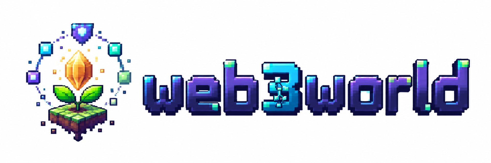
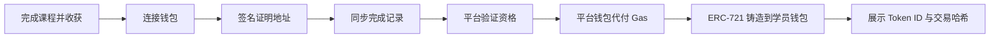

<p align="center">
  
</p>

<h1 align="center">web3world</h1>

<p align="center">
  <strong>把 Web3 课程、安全训练和知识锻造种进一片像素世界</strong><br />
  从课程土地到安全训练场，从回执池塘到铁匠铺，学习和成长都在同一张地图上发生。
</p>

<p align="center">
  一个把 Web3 课程、交易回执、安全训练和链上凭证放进像素世界的学习项目。
</p>

<p align="center">
  <a href="https://testnet.monadscan.com/address/0xc96a7087cfbbe5eb6f6f81a0905ad7a4d1375a5f">徽章合约</a>
  ·
  <a href="./docs/Monad像素农场_PRD_v3.5.md">产品文档</a>
</p>

## 介绍视频

<p align="center">
  
  <br />
  <sub>▶ 自动循环播放 · <a href="./docs/intro.mp4">观看完整 30 秒视频（含声音）</a></sub>
</p>

## 农场里有什么

农场地图、角色和三门基础课程构成了这个世界的地基：课程土地、知识塔、回执池塘、种子小铺和进步工坊各承担一段学习流程。在此基础上，本项目补齐了安全训练、知识锻造、第四块安全课程田和连续日夜变化，并修复了运行与布局问题。

| 基础玩法 | 安全与锻造扩展 |
| --- | --- |
| Web3 通识、Monad 基础、智能合约课程 | 第四块 Web3 安全课程田，各地点补充对应安全知识 |
| 课程土地、知识塔、池塘、种子小铺、进步工坊 | 独立 Web3 安全训练场入口、漏洞实验、交易检查与审计报告 |
| 像素农场探索 | 同一张地图上的连续昼夜、太阳升落与月亮接替，一天对应 24 秒 |
| 地图建筑和交互 | 铁匠铺像素模型、炉膛火焰、建筑碰撞与入口位置调整 |
| 学习与成长记录 | 三道 Web3 知识题、三件像素装备、答对解锁与装备穿脱 |

太阳和月亮属于地图顶部的天空，不固定在浏览器视口，也不会跟着玩家出现在头顶。光线连续变化，铁匠铺和安全训练场随天色变暗，炉膛火焰单独发光。

## web3world 是什么

一张可以探索的 Web3 学习地图。课程土地用于建立基础，回执池塘用于核对链上结果，安全训练场用于练习识别漏洞和交易风险，铁匠铺把知识问答的成果记录为装备。

## 五章安全旅程

```text
第一章 Learn  学习 Web3 / Monad / Solidity 基础（三门基础课程）
第二章 Break  在安全温室里亲手看到重入漏洞发生（Attack Replay）
第三章 Fix    找漏洞 + 选择修复方案 + 回归验证
第四章 Guard  把同样的知识用于真实交易前的 SignGuard 检查
第五章 Prove  生成 Audit Report + 领取 Security Passport
```

## 项目背景

Web3 的第一道门槛往往不是操作，而是理解：钱包、Gas、交易确认、区块浏览器、智能合约和链上凭证彼此关联，却通常被拆散在文档、教程和工具中。新用户记住了概念，也未必建立了完整的行动路径。

web3world 希望把这条学习路径变成一段可以探索、可以验证、也可以反复练习的旅程。

在这里，一门课程是一块土地，一颗种子是一条知识主线。玩家需要亲手开荒、播种、学习、挑战、验证和收获。抽象的进度会变成土地与作物的真实变化；当课程完成后，玩家可以连接钱包、签名证明地址，由平台验证完成记录并代付 Gas，将不可转让的 ERC-721 学习徽章铸造到学员钱包。

> **先看清，再签名；先练习，再上链。**

## 我们能为 Monad 带来什么

### 1. 更自然的新用户入口

把 Monad、EVM、交易确认和智能合约知识放进可探索的像素农场，用任务、地图和作物成长降低第一次接触区块链的理解成本。

### 2. 从“看过教程”走向“真正使用网络”

学习者不仅阅读内容，还会连接钱包、切换 Monad Testnet、签名证明地址、查看交易状态和使用区块浏览器。钓鱼玩法支持真实测试网交易，课程完成后则会触发真实的 ERC-721 徽章铸造。

### 3. 为生态建立可验证的学习凭证

课程完成记录先由平台验证，再与学员签名的钱包地址绑定。最终颁发的 Soulbound ERC-721 徽章不可转让，更适合表达“这个地址完成过什么学习”，而不是可以交易的普通道具。

### 4. 把教育转化为开发者成长漏斗

农场可以继续扩展更多课程格、生态项目任务、开发挑战和活动徽章，为 Monad 项目方提供从认知、体验、实践到身份沉淀的一体化入口。

## 我们能为 Web3 带来什么

- **更低的学习压力**：用种田、探索和收获替代连续的术语灌输。
- **更清晰的成长反馈**：未开荒、播种、发芽、开花、结果和收获分别对应真实学习节点。
- **更安全的首次链上体验**：钱包签名只用于证明接收地址；徽章由平台钱包代付 Gas，避免新用户因余额不足中断学习。
- **更可信的学习成果**：平台验证课程完成状态，链上徽章记录最终成果，并提供 Token ID、交易哈希和浏览器链接。
- **可复用的课程容器**：九格课程田可以承载 Web3 基础、Monad、智能合约以及未来的生态协议课程。

## 核心体验

| 模块 | 当前能力 |
| --- | --- |
| 全屏农场探索 | WASD、方向键、点击寻路、碰撞、镜头跟随和地点交互 |
| 九格课程田 | 一格一课程、一课一种子，按顺序解锁与成长 |
| 三门首发课程 | Web3 通识、Monad 基础、智能合约 |
| 第四块安全课程田 | 独立标记与安全训练场入口 |
| 连续日夜 | 同一地图中连续变化，24 秒完成一天，日月位于地图顶部天空 |
| 铁匠铺 | 三道知识题、三件像素装备、锻造解锁和装备穿脱 |
| 动态种植反馈 | 开荒、播种、发芽、开花、结果、收获七阶段 |
| 回执池塘 | 普通练习与 Monad Testnet 真实交易，10 种鱼类图鉴 |
| 成长档案 | EXP、课程果实、种子、完成状态与四类 NFT 徽章 |
| 链上学习徽章 | 钱包签名、平台验证、Gas 代付、ERC-721 铸造与链上凭证展示 |
| **Web3 安全温室** | 攻击回放、修复回归、SignGuard 交易安检门、最终审计与 Security Passport |

## Web3 安全温室（Monad Guardian Farm）

完成智能合约课程并收获果实后，废弃温室会解锁为 **Web3 安全温室**。

| 状态 | 条件 | 画面 |
| --- | --- | --- |
| locked | 智能合约课程未收获 | 温室 + 锁 |
| ruined | 安全温室已解锁 | 废弃温室可进入 |
| frame-repaired | Lab 1 完成 | 第一阶段素材 |
| secured | Lab 1 + Lab 2 + Lab 3 完成 | 第二阶段素材 + 防护特效 |
| fully-powered | Final Audit 通过 | 完整温室点亮 + Security Passport |

### 三个 Lab + 一次综合审计

- **Lab 1 · 重复提款（Reentrancy）**：点击危险代码行 → 14 步 Attack Trace（CALL DEPTH / CALLER / CALLEE / VALUE / 两侧余额 / STATE UPDATED）→ 选择修复方案 → 重新攻击 → `ATTACK BLOCKED` + Regression PASS。
- **Lab 2 · ERC20 权限与签名**：`mint()` 权限缺失（含“只加 onlyOwner 是否绝对安全”的追问）+ Signature Replay 模拟器。
- **Lab 3 · 用户侧攻击面**：`tx.origin` 钓鱼链路 + `setApprovalForAll` 与单枚 `approve` 的权限范围对比。
- **Final Audit**：给一份组合型合约提交结构化 Finding（title / type / severity / evidenceLines / rootCause / impact / fix），由确定性规则判分（漏洞识别 30 + 根因 25 + 修复 20 + 回归 15 + 表达 10 − 误报 10/条），阈值 70 分。

### SignGuard 2.0（交易安检门）

先给结论 **ALLOW / REVIEW / BLOCK**，再给分数与技术证据：

| 规则 | 触发条件 | 结论 |
| --- | --- | --- |
| TX-001 | `approve(spender, MaxUint256)` | BLOCK |
| TX-002 | `setApprovalForAll(operator, true)` | BLOCK |
| TX-003 | unknown selector + native value > 0 | REVIEW |
| TX-004 | 钱包网络 ≠ Monad Testnet | BLOCK |
| TX-005 | 本项目已验证教学合约 | INFO（仍然逐项展示 method / value / permission） |

支持三种输入：固定样例、待签名交易（address + calldata + value）、真实 Monad Testnet 交易哈希。
SignGuard 不会接收私钥 / 助记词，也不会替用户签名；未命中规则时页面固定提示“这不代表交易绝对安全”。

### Web 安全训练场

安全温室内另有一条与链上实验分开的 Web 安全训练路线，用来补齐 Web 应用本身的安全边界。当前包含：

- 反射型 XSS：输入输出上下文、自动转义、CSP 纵深防御；
- CSRF：会话 Cookie、CSRF Token、Origin / SameSite；
- SQL 注入：参数化查询与数据库最小权限；
- IDOR 越权：认证与对象级授权的区别；
- SSRF：出站域名白名单、DNS 解析、私网与重定向阻断。

每个主题都按“危险信号 → 根因与影响 → 修复方向 → 回归验证”展示，并通过本地模拟选择题完成验证。该模块不发送外部请求、不接收真实凭据，也不接受任意目标地址；它与 Web3 安全 Lab、SignGuard 的判定相互独立。

### 教学靶场合约

```text
onchain/contracts/labs/VulnerableBank.sol   # 故意保留重入漏洞（EDUCATIONAL / TESTNET ONLY）
onchain/contracts/labs/PatchedBank.sol      # Checks-Effects-Interactions 修复版
onchain/test/ReentrancyLab.t.sol            # 漏洞版必须可被抽干；修复版必须阻断攻击
```

> ⚠️ 以上合约仅用于教学与测试网演练。请勿部署到主网，请勿向其发送任何具有真实价值的资产，也不要针对真实协议复现同类攻击。


## NFT 领取流程



当前徽章合约部署于 **Monad Testnet（Chain ID 10143）**：

[`0xc96a7087cfbbe5eb6f6f81a0905ad7a4d1375a5f`](https://testnet.monadscan.com/address/0xc96a7087cfbbe5eb6f6f81a0905ad7a4d1375a5f)

| Type ID | 课程 | 徽章 |
| ---: | --- | --- |
| 0 | Web3 通识 | 账本守护者 |
| 1 | Monad 基础 | Monad 探索者 |
| 2 | 智能合约 | 合约建造师 |
| 3 | Web3 安全温室 | Web3 Security Guardian（Security Passport） |

> 当前部署面向 Monad Testnet。课程徽章为不可转让 ERC-721，用于记录学习成果，不代表金融资产或收益承诺。
> Security Passport（typeId 3）额外记录 Reentrancy / Access Control / Transaction Guard 的通过情况、Audit Score 与报告哈希，资格由服务端根据 D1 记录计算。

## 技术架构

- **前端**：Next.js 16、React 19、DOM/CSS 像素场景、Three.js 安全训练场模型
- **Cloudflare 运行时**：Vinext、Workers、Static Assets
- **数据库**：Cloudflare D1、Drizzle ORM
- **链交互**：Viem、Monad Testnet
- **智能合约**：Solidity 0.8.28、OpenZeppelin ERC-721、Foundry
- **寻路与场景**：24px 导航网格、A*、`requestAnimationFrame`

## 快速开始

环境要求：Node.js `>=22.13.0`。

```bash
npm ci
npx wrangler d1 execute monad-pixel-farm-db --local --file=scripts/init-d1.sql
npm run dev
```

默认访问地址为 `http://localhost:3000`。

只查看地图与本地交互，可以访问 `/?preview=home`。预览不会保存学习进度，连续日夜默认开启，不需要分别打开白天和黑夜页面。钱包、链上铸造及登录接口仍需要相应服务配置。

> `scripts/init-d1.sql` 会删除并重建本地数据表，只能在新的、可丢弃的本地 D1 状态上执行；不要对已有 `.wrangler` 数据重复运行。需要隔离本地数据时，可设置 `MONAD_FARM_PERSIST_PATH`，并在 Wrangler D1 命令中使用相同的 `--persist-to` 路径。

```powershell
$env:MONAD_FARM_PERSIST_PATH = "$env:TEMP\monad-farm-local"
npm run dev -- --hostname 127.0.0.1 --port 3001
```

### 本地链上配置

复制环境变量模板：

```bash
cp .dev.vars.example .dev.vars
```

| 变量 | 用途 |
| --- | --- |
| `MONAD_RPC_URL` | Monad Testnet RPC |
| `BADGE_CONTRACT_ADDRESS` | 课程徽章合约地址 |
| `MINTER_PRIVATE_KEY` | 平台铸造钱包私钥，仅服务端使用 |

请勿提交 `.dev.vars`、`.env` 或任何真实私钥。

## 验证与构建

```bash
npm run lint
npm test
npm run contract:compile
```

`npm test` 会先进行生产构建，再执行状态机、探索交互、课程成长、钓鱼、后端数据流程与安全模块测试（规则引擎、SignGuard、安全进度、审计报告、安全数据层）。

本地运行生产构建：

```bash
npm run build
npm start -- --hostname 127.0.0.1 --port 3012
```

重新构建后需要重启生产服务器，再刷新浏览器。旧进程引用的 JS/CSS 文件名可能与新构建不一致，造成资源 404、样式丢失或空白页面。

> Windows 提示：`npm ci` 在缺少 Visual Studio C++ 工具链时会因为 `better-sqlite3` 的隐式 node-gyp 构建而报错。
> 它自带 `prebuilds/` 预编译二进制，运行期并不需要重新编译，因此本地可用
> `npm ci --ignore-scripts`（或 `npm install --ignore-scripts`）完成安装，然后正常执行 lint / build / test。

## 安全模块 API

```text
GET  /api/security/scenarios              安全场景与 Lab 元数据
POST /api/security/session/start          开始 / 恢复一次安全实验（需登录）
POST /api/security/session/step           服务端判定单个步骤（幂等，需登录）
GET  /api/security/session/status         聚合安全进度与 Passport 资格（需登录）
POST /api/security/finding                提交审计 Finding（确定性判分，需登录）
POST /api/security/report                 生成审计报告（服务端权威，需登录）
GET  /api/security/report/:id?format=md   读取 / 下载自己的报告（需登录）
POST /api/security/passport/eligibility   服务端计算 typeId 3 资格（需登录）
POST /api/security/tx-analyze             SignGuard 交易风险解释
POST /api/security/agent/propose          自然语言意图 → 结构化 Proposal（确定性映射）
POST /api/security/agent/check            FarmBot 策略引擎 Allow / Block
POST /api/agent/security-review           Finding 语义评阅（规则模式，故障可降级）
GET  /api/chain/tx?hash=0x...             读取 Monad Testnet 交易（需登录）
GET  /api/chain/receipt?hash=0x...        读取交易回执（需登录）
```

安全约束：RPC 固定服务端地址、不接受用户自定义 RPC；tx hash / 地址 / calldata 全部做格式校验；交易风险检查只保存 calldataHash 与命中规则，不落库完整 calldata；`MINTER_PRIVATE_KEY` 只在服务端使用。

## 部署

### Cloudflare Workers

```bash
npm run build
npx wrangler deploy
```

正式环境中的铸造私钥应使用 Cloudflare Secret：

```bash
npx wrangler secret put MINTER_PRIVATE_KEY
```

### 部署新的测试网徽章合约

```bash
npm run contract:deploy:testnet
```

部署脚本会创建合约、初始化三类徽章，并为平台钱包开启 minter 权限。

## 项目结构

```text
├── app/
│   ├── api/                    # 钱包挑战、进度、资格、NFT 铸造与安全模块接口
│   └── game/
│       ├── FarmGame.tsx        # 农场主界面（安全温室只做入口与路由）
│       └── security/           # Web3 安全温室 UI（Lab / Attack Trace / SignGuard / Audit / Passport）
├── db/                         # D1 / Drizzle 数据结构（含 security_* 四张表）
├── drizzle/                    # 远端数据库增量迁移（0003_security_lab.sql）
├── lib/
│   ├── repositories.ts         # 数据访问层（含安全 session / finding / report）
│   └── security/               # 纯安全核心库：rules / decoder / risk-engine / scoring / report / passport
├── onchain/
│   ├── contracts/NFTBadge.sol  # Soulbound ERC-721 徽章合约（typeId 0/1/2/3）
│   ├── contracts/labs/         # 教学靶场合约（EDUCATIONAL / TESTNET ONLY）
│   └── test/                   # Foundry 合约测试（NFTBadge + ReentrancyLab）
├── public/art/                 # 地图、角色、作物、鱼类、徽章与温室素材
├── scripts/                    # D1、合约编译与部署脚本
├── tests/                      # 状态机、交互、渲染与安全模块测试
└── wrangler.jsonc              # Cloudflare Workers 配置
```

## 当前边界与下一步

三门基础课程、钱包连接、钓鱼上链和课程徽章流程全部保留。本版本新增第四块安全课程田、安全训练场与铁匠铺，并补充连续昼夜与模型、布局、动画兼容性修复。学习和装备状态保存在浏览器本地；领取徽章还需要钱包、服务端数据库及链上配置，不应把本地演示当作真实铸造成功。

后续方向包括：

- 将更多学习事件沉淀为可跨平台验证的证明；
- 为 Monad 生态项目开放课程格和联合任务；
- 扩展课程徽章、活动徽章与开发者成就体系；
- 引入 Agent 动态验证和更完整的学习分析。

## 文档

- [产品需求文档 v3.5](./docs/Monad像素农场_PRD_v3.5.md)
- [前端交互说明 v3.5](./docs/Monad像素农场_前端交互说明_v3.5.md)
- [API 文档 v1.0](./docs/API文档_v1.0.md)
- [前端联调清单](./docs/P0前端联调清单.md)

---

如果 Web3 学习可以像经营一座农场一样自然，那么每一次理解、实践与验证，都应该在世界里留下痕迹。
