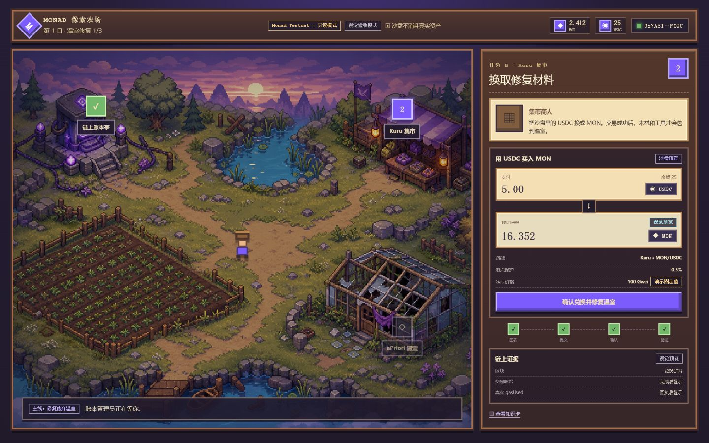

# Monad 像素农场：Web3 互动学习平台 PRD

版本：v1.0  
状态：团队执行版  
日期：2026-07-30  
产品形态：Monad/Web3 学习平台 + 像素经营游戏  
MVP 技术决策：不接入 Moss

> **一句话定义**：用户经营一座像素农场，通过短课程、互动练习、知识测验和可验证的 Monad 操作解锁土地、建筑与冒险记录，在玩的过程中建立 Web3 的基础认知和安全操作能力。

<!-- DOCX_BODY -->

## 0. 文档导航

本 PRD 用于统一产品、课程、前端、链上工程、宣发与测试工作。它定义 MVP 必须实现的学习闭环、游戏反馈、页面状态、数据边界和验收标准，不把完整农场经营、代币经济或 Moss 沙盘纳入第一版。

| 阅读对象 | 优先阅读章节 | 需要形成的结论 |
|---|---|---|
| 全体成员 | 1-4、19-22 | 产品做什么、不做什么、何时算完成 |
| 平台与课程 | 5-8、13、17 | 每关教什么、如何判断用户学会 |
| 前端与游戏 | 9-12、14-16 | 页面、状态、交互和异常如何实现 |
| 链上与平台工程 | 7、11、15-18 | 数据、验证、接口、安全和性能边界 |
| 宣发与生态运营 | 2、4、20-22 | 对外叙事、目标用户、演示路径和指标 |

> **正式决策**：MVP 不接入 Moss。产品核心从“依赖沙盘完成两笔协议交易”调整为“平台课程与游戏成长构成稳定主线，Monad Testnet 提供真实读取和可用性受控的链上实践”。任何模拟练习都必须明确标注为“互动练习”，不得显示为真实交易或真实链上余额。

## 1. 产品概述

### 1.1 产品背景

Web3 新用户面临的主要障碍不是缺少名词解释，是不理解钱包正在请求什么、不知道交易失败后资产是否安全、无法把地址、Gas、滑点、回执和 DeFi 凭证联系成完整过程。传统课程通常将知识、操作与反馈拆开；普通链游又经常只要求点击签名，没有解释用户完成了什么。

Monad 像素农场把学习任务变成经营目标：用户完成一个知识与操作闭环，农场才发生一次清晰、可见的成长。链上能力是推动世界变化的条件，像素经营则提供情绪价值、进度感与回访理由。

### 1.2 产品定位

- **品类**：游戏化 Web3 学习平台。
- **首发主题**：Monad 新手入门。
- **体验承载**：治愈系原创像素农场。
- **核心价值**：安全地学、清楚地做、可回看地证明。
- **首版终点**：完成三关，修复废弃温室，生成 Monad 冒险记录。

### 1.3 产品原则

1. **学习先于签名**：用户在点击钱包按钮前，必须知道动作、资产变化、风险和完成证据。
2. **世界变化对应能力变化**：每次解锁必须对应一个已掌握的 Web3 能力。
3. **证据分层展示**：平台学习证据与链上证据分别展示，绝不混淆。
4. **短任务、强反馈**：单屏只要求一个主要动作，完成后立即反馈农场成长。
5. **失败不惩罚学习进度**：签名拒绝、RPC 超时或交易回滚不得清除已完成课程。
6. **不承诺收益**：质押课程只解释机制、凭证与风险，不宣传固定回报。
7. **原创表达**：借鉴温暖农场氛围，不复刻现有游戏的角色、地图、图标、边框或文案。

## 2. 目标与非目标

### 2.1 MVP 产品目标

- 让首次接触 Web3 的用户在 12 分钟内完成三关连续体验。
- 让用户能够解释钱包地址、读取与写入、Gas、滑点、交易回执、流动性质押凭证六个核心概念。
- 让用户至少完成一次真实 Monad 链上读取，并看到来源清晰的区块与余额信息。
- 让用户完成至少两次平台互动练习和两组知识测验。
- 让每关完成结果驱动地图、道具或温室状态发生明确变化。
- 生成可回看的个人冒险记录，分别记录学习结果与链上证据。
- 为后续新增 Monad 生态课程建立可复用的课程、任务和验证框架。

### 2.2 MVP 非目标

- 不开发完整种植周期、自由钓鱼、背包合成、交易市场、战斗或社交系统。
- 不发行平台代币、NFT、可转让道具或收益型游戏资产。
- 不把土地、作物、经验值和建筑状态全部写入链上。
- 不接入 Moss，不依赖 Fork、资产预置或沙盘会话才能完成主线。
- 不要求用户投入主网真实资产。
- 不承诺 Kuru、aPriori 或其他外部协议在任意时间都可用。
- 不在 MVP 建设复杂课程编辑后台；课程内容可以由版本化配置维护。
- 不做移动端完整操控，移动端只提供介绍和桌面体验提示。

## 3. 成功定义与发布门槛

### 3.1 北极星指标

**有效学习通关数**：用户完成三关、通过每关测验并生成冒险记录的次数。链上实践是否完成作为单独维度记录，不影响“学习通关”的真实性。

### 3.2 MVP 内部目标

| 指标 | 目标 | 统计口径 |
|---|---:|---|
| 首次有意义动作时间 | 90 秒以内 | 进入首页到开始任务 A |
| 三关学习通关率 | 不低于 80% | 进入任务 A 的测试用户中完成任务 C |
| 单次主线时长 | 8-12 分钟 | 从开始任务 A 到生成记录 |
| 核心测验正确率 | 不低于 80% | 三关全部核心题 |
| 真实链上读取成功率 | 不低于 95% | 钱包与 RPC 均可用的请求 |
| 死路页面数量 | 0 | 任何失败状态都有重试、返回或继续学习入口 |
| 演示连续成功率 | 10 次中 10 次 | 使用既定演示账户和环境 |

### 3.3 发布阻断项

- 任一界面把互动练习标记为真实链上交易。
- 钱包拒绝签名后仍解锁链上实践奖励。
- 交易回执失败却显示成功或改变农场状态。
- 刷新后已完成课程丢失，或连接另一钱包后错误继承链上证据。
- 页面展示未标注来源的预置余额、固定 Gas 或收益数字。
- 课程内容缺少风险说明，或使用“稳赚”“保证收益”等表达。
- 1440×900 主演示路径出现遮挡、溢出、模糊像素或无法点击。

## 4. 目标用户与使用场景

### 4.1 核心用户

#### 用户 A：Web3 初学者

- 了解“钱包”和“交易”词汇，但没有独立完成过链上操作。
- 最大顾虑是签错、转错、看不懂弹窗和损失资产。
- 需要短解释、低压力环境和明确的完成反馈。

#### 用户 B：从其他链进入 Monad 的用户

- 已使用过 EVM 钱包，但不熟悉 Monad 生态入口和协议。
- 希望快速确认网络、浏览器、资产和常见操作路径。
- 更关注链上证据、协议差异和操作效率。

#### 用户 C：Workshop、校园社群和黑客松参与者

- 需要一条可统一组织、可现场演示、可复盘的学习路线。
- 组织者需要知道参与者完成到哪一关、在哪一步失败。
- 需要课程链接、分享素材和简短的学习结果。

### 4.2 次要用户

- Monad 生态协议方：未来提供协议课程、知识卡和验证规则。
- 课程运营者：维护课程内容、题目、顺序和发布状态。
- 评委与合作方：在 3-5 分钟内理解产品价值和技术可信度。

### 4.3 核心使用场景

1. 用户从社群链接进入，先看 30 秒产品说明，再开始修复温室。
2. 用户连接钱包并读取 Monad 公开状态，不发生任何签名。
3. 用户通过互动练习理解交易结构、Gas 和滑点。
4. 外部协议可用时，用户选择进入真实测试网实践；不可用时继续课程。
5. 用户完成流动性质押课程，理解凭证、兑换率和风险。
6. 用户查看冒险记录，回顾知识点、测验结果和链上证据。
7. 用户返回平台，看到已完成区域和下一条课程路线。

## 5. 核心体验模型

### 5.1 核心循环

1. NPC 发布一个农场目标。
2. 界面说明本关学习目标与本次动作。
3. 用户阅读知识卡或直接进入互动步骤。
4. 用户完成平台练习、测验或真实链上操作。
5. 系统验证完成证据。
6. 农场出现一次成长变化。
7. 冒险记录增加知识、成绩和证据。
8. 下一块区域或课程解锁。

### 5.2 双层完成机制

| 层级 | 定义 | 完成方式 | 对游戏的影响 |
|---|---|---|---|
| 学习完成 | 用户理解并通过本关目标 | 完成交互步骤并通过核心测验 | 解锁主线、地图成长、经验值与徽章 |
| 链上实践完成 | 用户完成经过验证的测试网动作 | 真实读取或成功回执加状态变化 | 增加“链上实践”印章和证据记录 |

> **关键规则**：链上实践是增强层，不是主线可用性的单点依赖。外部 RPC 或协议不可用时，平台仍可完成教学闭环，但不得授予链上实践印章。

### 5.3 游戏成长映射

| 学习能力 | 农场叙事 | 世界变化 | 用户奖励 |
|---|---|---|---|
| 认识钱包、地址和公开读取 | 唤醒农场账本 | 荒地出现嫩芽，账本亭点亮 | 账本徽章、第一块土地 |
| 理解交易、Gas、Swap 和滑点 | 获取温室修复材料 | 工具箱、木材出现，温室骨架修复 | 交易徽章、工具槽位 |
| 理解质押凭证、兑换率和风险 | 注入温室长期能源 | 温室亮灯、作物成长、夜景完成 | DeFi 徽章、温室区域 |

## 6. 信息架构

### 6.1 一级结构

- **首页**：产品介绍、继续冒险、课程价值、安全说明。
- **学习岛**：农场地图、当前任务、课程进度和成长反馈。
- **课程中心**：课程路线、难度、先修关系、预计时长。
- **冒险记录**：课程成绩、知识卡、链上证据和徽章。
- **帮助与安全**：钱包说明、风险提示、常见问题和问题反馈。

### 6.2 MVP 页面清单

| 页面 | 主要目的 | 核心动作 | MVP 优先级 |
|---|---|---|---|
| 首页/新手引导 | 解释产品并降低钱包焦虑 | 开始冒险、继续进度 | P0 |
| 学习岛主界面 | 承载地图、任务和成长 | 进入当前任务 | P0 |
| 课程任务页 | 完成知识、练习和测验 | 下一步、提交答案 | P0 |
| 链上实践控制台 | 读取或提交测试网操作 | 连接、确认、重试 | P0 |
| 知识卡 | 按需解释当前概念 | 标记已读、返回任务 | P0 |
| 任务完成页 | 展示证据与世界变化 | 查看记录、进入下一关 | P0 |
| 冒险记录 | 回顾学习与链上证据 | 展开记录、复制哈希 | P0 |
| 课程中心 | 展示当前与后续路线 | 查看课程、继续学习 | P1 |
| 个人设置与帮助 | 管理钱包、数据与反馈 | 断开、重置、反馈 | P1 |

### 6.3 导航规则

- 首次进入优先展示首页；已开始用户的主按钮显示“继续修复温室”。
- 桌面端顶部导航固定提供学习岛、课程中心、冒险记录和帮助。
- 任务进行中离开页面时自动保存平台进度；返回后定位到最后一个已确认步骤。
- 链上交易提交后允许离开任务页，但顶部必须持续显示交易状态入口。
- 未完成先修课程时，后续课程可查看简介，不允许进入完成流程。

## 7. 三关课程详细设计

### 7.1 任务 A：唤醒农场账本

**学习目标**：用户能区分钱包地址、公开读取与签名写入，并能指出本次操作没有改变资产。

**叙事目标**：账本管理员需要确认农场主人身份，才能点亮账本亭和第一块土地。

**前置条件**：

- 浏览器支持桌面页面。
- 用户可以选择连接钱包；未安装钱包时可进入不含链上印章的课程演示。
- 真实读取只使用当前配置的 Monad 网络公共客户端。

**任务步骤**：

1. 阅读“本次只读取公开信息，不需要签名”的操作说明。
2. 点击连接钱包。
3. 钱包返回地址；网络不正确时请求切换到目标 Monad 网络。
4. 平台读取网络标识、区块高度、原生余额与课程所需 Token 余额。
5. 页面展示每项数据的来源和“真实读取”标记。
6. 用户回答核心题：“为什么读取余额不需要签名？”
7. 验证通过后点亮账本亭。

**核心测验**：

- 正确答案必须包含“公开状态可以被查询”和“没有改变链上状态”。
- 首次答错给出概念提示，不直接显示最终答案。
- 第二次答错展示知识卡，阅读后可重新作答。

**学习完成条件**：

- 已查看读取结果或完成无钱包课程演示。
- 核心题回答正确。

**链上实践完成条件**：

- 成功获取钱包地址。
- 读取网络标识、区块高度和至少一项余额成功。
- 全流程没有出现交易签名请求。

**游戏反馈**：

- 土地颜色由灰褐变为绿色。
- 账本亭点亮，出现三株嫩芽。
- 获得“公开账本”徽章。

**异常处理**：

- 未安装钱包：解释安装路径，并提供“先学习，稍后连接”。
- 用户拒绝连接：保留课程位置，不显示错误惩罚。
- 网络切换失败：展示当前网络与目标网络，提供重试。
- RPC 失败：保留钱包连接，允许重新读取；课程演示仍可继续。

### 7.2 任务 B：换取温室修复材料

**学习目标**：用户能解释交易签名、Gas、授权、报价、滑点、最少获得量和回执状态。

**叙事目标**：集市商人要求用户理解交易条件，才能领取木材与工具。

**默认教学模式**：平台互动练习，不发起链上交易。

**可选实践模式**：仅在目标网络、协议、市场和测试资产通过启动检查后开放真实测试网操作。

**任务步骤**：

1. 识别支付资产、目标资产、路线、预计获得、最少获得和 Gas。
2. 在交易拆解练习中把“授权”“Swap”“回执”排列为正确顺序。
3. 调整滑点选项，观察最少获得量如何变化。
4. 回答“滑点保护触发时应成交还是回滚”的核心题。
5. 选择完成互动练习，或进入真实测试网实践。
6. 平台验证结果并发放修复材料。

**互动练习规则**：

- 所有金额使用“练习数据”徽章。
- 钱包按钮不出现，页面不生成交易哈希。
- 练习结果只记录选择、答题和完成时间。
- 完成后显示“平台学习证据”，不显示“链上实践印章”。

**真实实践开放条件**：

- 当前网络配置检查通过。
- 目标合约 bytecode、Token decimals 和市场状态检查通过。
- 用户余额满足支付额和 Gas 缓冲。
- 报价生成时间未超过产品配置的有效窗口。
- 页面明确显示测试网、资产来源和实际可能发生的余额变化。

**真实实践验证条件**：

- 授权与 Swap 回执均为成功。
- 支付资产余额减少。
- 目标资产余额增加。
- 记录交易哈希、区块号、实际 gasUsed 和前后余额。

**学习完成条件**：

- 交易顺序练习正确。
- 滑点核心题正确。
- 阅读回执状态说明。

**游戏反馈**：

- 地图出现工具箱、木材和修复工人特效。
- 温室从废墟切换为“骨架修复”状态。
- 获得“交易守门人”徽章。

**异常处理**：

- 用户拒绝授权或交易：不改变游戏状态，保留练习完成结果。
- 报价过期：自动刷新，要求重新确认关键数值。
- 余额不足：说明支付资产与 Gas 分别缺少多少。
- 市场不可用：关闭真实实践入口，课程主线继续可用。
- 交易长时间未确认：持续展示哈希和查询入口，不重复提交。
- 回执失败：显示失败原因与安全说明，不授予链上实践印章。

### 7.3 任务 C：为温室注入长期能源

**学习目标**：用户能解释质押、流动性质押凭证、兑换率、收益来源和主要风险。

**叙事目标**：园艺师需要一个可持续能源核心，让温室长期运转。

**默认教学模式**：通过资产变化图和风险决策完成互动练习。

**可选实践模式**：外部协议与测试网状态通过检查后，允许用户存入限定数量的测试网 MON。

**任务步骤**：

1. 阅读“存入 MON、获得凭证、凭证代表协议头寸”的说明。
2. 观察兑换率变化对预计凭证数量的影响。
3. 从风险列表中选出协议风险、流动性风险和赎回时间风险。
4. 选择保留 Gas 缓冲，不允许使用全部原生资产。
5. 完成互动练习，或进入真实测试网实践。
6. 验证完成后启动温室。

**真实实践开放条件**：

- 协议存款功能可用且未暂停。
- 兑换率读取成功。
- 存入数量低于可用 MON 扣除 Gas 缓冲后的余额。
- 页面不显示保证收益或固定回报。

**真实实践验证条件**：

- 存款交易回执成功。
- MON 余额减少。
- 质押凭证余额增加。
- 记录实际 gasUsed、前后余额和兑换率快照。

**学习完成条件**：

- 正确识别三类风险。
- 正确解释“凭证数量不一定自动增加，价值可能通过兑换率体现”。
- 明确知道收益不受保证。

**游戏反馈**：

- 温室亮灯，玻璃出现高光和能量粒子。
- 作物进入成熟状态，夜景完成。
- 获得“温室守护者”徽章并生成冒险记录。

**异常处理**：

- 协议暂停：关闭真实实践入口并说明原因。
- 兑换率读取失败：不展示预计凭证数量。
- 用户输入全部余额：按钮禁用并解释 Gas 缓冲。
- 交易失败：温室不启动，练习完成进度仍保留。

## 8. 课程与内容系统

### 8.1 课程最小结构

每节课必须包含：

- 一句可测量的学习目标。
- 一个对应世界变化的游戏目标。
- 1-3 个必要概念。
- 一个当前主要动作。
- 一个核心测验。
- 一条平台学习完成规则。
- 一条可选链上实践验证规则。
- 一个失败恢复路径。
- 一张可回看的知识卡。

### 8.2 知识卡规范

- 标题直接回答一个问题，不使用抽象章节名。
- 首屏正文不超过 120 个汉字。
- 固定包含“本关动作”“资产变化”“安全检查或风险”三个标签。
- 术语首次出现提供一句白话解释。
- 真实数值必须标明来源；教学数值标记“练习数据”。
- 卡片阅读不是唯一完成条件，必须与练习或测验配合。

### 8.3 测验规范

- 每关 2-3 题，其中 1 题为核心题。
- 核心题必须正确才能学习完成。
- 错误反馈解释“为什么”，不只显示对错。
- 同一题连续错误两次后自动推荐对应知识卡。
- 记录作答次数、最终结果和耗时，不记录键盘输入内容。

### 8.4 课程发布状态

| 状态 | 用户可见性 | 行为 |
|---|---|---|
| 草稿 | 不可见 | 内容与规则可继续修改 |
| 内测 | 仅测试入口 | 记录测试数据，不出现在公开路线 |
| 已发布 | 公开可见 | 可学习、保存进度、生成记录 |
| 已暂停 | 显示维护说明 | 已完成记录可查看，不可新开始 |
| 已归档 | 仅历史记录可见 | 不进入推荐与课程中心 |

## 9. 页面级需求

### 9.1 首页与新手引导

**首屏必须展示**：

- 产品名称和一句话价值。
- “开始冒险”或“继续冒险”主按钮。
- 三步路线：认识账户、理解交易、掌握 DeFi 风险。
- “学习模式不消耗真实资产”的说明。
- 真实链上实践为测试网增强功能的说明。

**交互规则**：

- 未登录或未连接钱包也能开始课程。
- 钱包连接不是进入平台的强制门槛。
- 返回用户根据本地或账户进度显示继续位置。
- 1280px 以下显示桌面体验建议，不加载复杂地图交互。

### 9.2 学习岛主界面

**布局**：

- 顶部 HUD：课程日、温室修复进度、环境标签、钱包状态、背包。
- 左侧地图：账本亭、集市、温室三个热点。
- 右侧任务台：NPC 对话、当前动作、步骤、证据和知识入口。

**状态表达**：

- 未解锁：灰度、锁图标和先修说明。
- 可开始：数字标识、轻微呼吸动画和“开始”提示。
- 进行中：紫色边框、当前步骤和保存状态。
- 已完成：绿色勾选、建筑变化和完成时间。
- 维护中：橙色工具图标和维护说明。

### 9.3 课程任务页

- 顶部显示课程名、学习目标、预计时长和当前步骤。
- 每屏只有一个主要按钮。
- “上一步”不清除已提交结果。
- 用户离开前保存当前步骤。
- 测验提交后展示解释，再允许继续。
- 课程完成前不得直接跳到完成动画。

### 9.4 链上实践控制台

固定分为四层：

1. **动作说明**：本次要做什么、会不会改变资产。
2. **参数确认**：输入、输出、网络、合约或协议、Gas 和风险。
3. **进度时间线**：等待钱包、已提交、确认中、验证中、完成。
4. **证据区**：哈希、区块、gasUsed、前后余额和验证结论。

**徽章类型**：

- 真实读取。
- 真实测试网交易。
- 练习数据。
- 固定教学值。
- 外部服务维护。

### 9.5 任务完成页

- 先展示“学会了什么”，再展示“获得了什么”。
- 显示农场世界变化前后对照。
- 平台学习证据和链上证据分为两个卡片。
- 没有完成真实实践时显示“链上实践尚未完成”，不显示空哈希。
- 提供下一关、查看知识卡和返回地图三个入口。

### 9.6 冒险记录

每关记录包含：

- 课程名称、完成时间、测验结果和知识卡。
- 游戏奖励、地图变化和徽章。
- 是否完成链上实践。
- 链上网络、地址缩略、交易哈希、区块、gasUsed 和余额变化。
- 证据复制与区块浏览器入口。

隐私规则：

- 默认只显示缩略地址。
- 分享卡不包含完整钱包地址。
- 用户可删除本地学习记录；链上公开记录无法由平台删除。

## 10. 游戏系统需求

### 10.1 进度系统

- 主线进度为 0/3、1/3、2/3、3/3。
- 课程学习完成后立即解锁下一关。
- 链上实践印章独立于主线进度。
- 重复学习不重复发放同一徽章，但更新测验成绩和完成时间。
- 更换钱包不会清除平台学习进度；链上证据按钱包分别归档。

### 10.2 农场状态

| 阶段 | 地图状态 | 温室状态 | 可交互区域 |
|---|---|---|---|
| 0 | 薄雾、荒地 | 废弃 | 账本亭 |
| 1 | 嫩芽与第一块绿地 | 废弃 | 账本亭、集市 |
| 2 | 工具箱与木材 | 骨架修复 | 三个区域 |
| 3 | 作物成熟、灯光与粒子 | 正常运转 | 三个区域、冒险记录 |

### 10.3 奖励系统

- 奖励仅为平台内非转让内容：经验值、徽章、土地、建筑状态和知识卡。
- 奖励不具有货币价值，不可交易或提现。
- 链上实践印章只用于证明完成过验证动作。
- 宣传页面不得把平台奖励表述为投资回报。

### 10.4 动画与反馈

- 普通交互反馈在 100 毫秒内出现。
- 课程完成动画控制在 2-4 秒，可跳过。
- 交易确认等待时使用循环动画，不伪造进度百分比。
- 成功、失败和锁定同时使用颜色、图标与文字。
- 像素素材只按整数倍缩放，使用像素化渲染。

## 11. 状态机与完成规则

### 11.1 平台任务状态

| 状态 | 含义 | 允许动作 |
|---|---|---|
| 未解锁 | 先修课程未完成 | 查看简介 |
| 可开始 | 满足先修条件 | 开始课程 |
| 学习中 | 正在阅读或练习 | 继续、返回、保存 |
| 待测验 | 必要内容完成 | 提交答案 |
| 学习完成 | 测验与平台规则通过 | 解锁下一关、进入实践 |
| 实践进行中 | 链上动作已开始 | 查看状态、离开后返回 |
| 实践完成 | 链上验证通过 | 查看证据 |
| 实践失败 | 拒绝、超时或回滚 | 重试、返回课程 |

### 11.2 链上动作状态

当前前端原型已经使用以下阶段：`idle`、`wallet`、`signing`、`submitted`、`confirming`、`verifying`、`complete`。新版平台保留这些阶段的语义，并增加独立失败结果，不用“回到 idle”掩盖失败发生过。

### 11.3 幂等与恢复

- 同一课程的完成提交必须可重复调用而不重复发放奖励。
- 同一交易哈希只能绑定到一个钱包的一次实践记录。
- 页面刷新后从服务端或本地持久层恢复平台步骤。
- 已提交交易优先通过哈希恢复确认状态，不发起第二笔交易。
- 外部服务恢复后，用户可重新触发验证，不要求重新签名。

## 12. 关键用户流程

### 12.1 首次用户完整流程

1. 进入首页并了解学习模式。
2. 点击开始，进入废弃农场。
3. 完成任务 A 知识说明。
4. 选择连接钱包并完成真实读取，或先完成无钱包课程演示。
5. 通过核心测验，点亮账本亭。
6. 完成任务 B 交易结构与滑点练习。
7. 外部服务可用时选择真实测试网实践。
8. 通过核心测验，修复温室骨架。
9. 完成任务 C 凭证、兑换率与风险练习。
10. 选择是否进行真实测试网质押实践。
11. 温室启动，生成冒险记录。

### 12.2 返回用户流程

- 首页主按钮显示“继续任务名称”。
- 进入后恢复到最后一个已确认步骤。
- 若上次交易仍在确认，优先展示交易状态。
- 若连接的钱包不同，提示链上证据将记录在当前钱包下。

### 12.3 无钱包用户流程

- 可以完成三关学习与游戏成长。
- 任务 A 展示公开读取演示，但明确标记为“课程演示”。
- 冒险记录显示学习完成，不授予任何链上实践印章。
- 完成后推荐连接钱包补做真实读取。

## 13. 文案与教学体验规范

### 13.1 三段式说明

- **操作前**：告诉用户要做什么、是否改变资产、需要注意什么。
- **操作中**：解释钱包或网络正在等待什么，不使用模糊加载文案。
- **操作后**：解释状态与资产发生了什么变化，展示完成证据。

### 13.2 禁止表达

- “稳赚”“零风险”“保证收益”“无脑操作”。
- 把测试网资产称为真钱或奖励收入。
- 把练习数据称为链上余额、链上报价或真实 Gas。
- 在外部协议不可用时引导用户反复签名。

### 13.3 错误文案模板

错误提示必须包含：

1. 发生了什么。
2. 已完成的进度是否保留。
3. 资产是否发生变化。
4. 用户下一步可以做什么。

示例：“交易没有提交：你在钱包中取消了签名。课程进度已经保存，链上资产没有变化。你可以重新尝试或先返回知识卡。”

## 14. UI、视觉与响应式规范

### 14.1 主演示画布

- 目标画布为 1440×900。
- 外边距 24px，顶部 HUD 高 64px。
- 主地图宽 936px，任务控制台宽 440px，中间间隔 16px。
- 地图采用俯视 3/4 视角。
- DOM/CSS 承担中文、按钮和信息面板，生成图片只承担无文字美术。

### 14.2 视觉系统

| Token | 色值 | 用途 |
|---|---|---|
| 夜墨 | `#201A2B` | 页面背景、主要文字 |
| 深紫 | `#39304F` | 面板与次级标题 |
| 交互紫 | `#7C5CFC` | 主要操作与当前状态 |
| 木棕 | `#6B4636` | 农场边框与场景元素 |
| 羊皮纸 | `#F4E1B7` | 对话与知识内容 |
| 作物绿 | `#69A66F` | 成功与成长 |
| 水蓝 | `#55A6B7` | 真实读取与信息 |
| 警示橙 | `#F4B860` | 固定值、维护与提醒 |
| 错误红 | `#D95D5D` | 失败与危险操作 |

### 14.3 组件状态

以下组件必须覆盖默认、悬停、按下、禁用、加载、成功和失败状态：

- 主按钮、次按钮、危险按钮。
- 钱包连接和网络状态。
- Token 输入、余额、最大值与兑换箭头。
- 任务步骤、测验选项和交易时间线。
- 知识卡、证据卡、Toast 和错误恢复框。
- 地图热点、NPC 气泡、物品格和徽章。

### 14.4 响应式

- 1280px 及以上提供完整互动。
- 1024-1279px 提供缩放后的只读地图和课程面板，提示使用桌面。
- 1024px 以下提供首页、课程介绍、冒险记录查看，不提供地图操作和链上交易。

## 15. 数据与持久化

### 15.1 逻辑数据对象

| 对象 | 核心信息 | 作用 |
|---|---|---|
| 学习账户 | 用户标识、创建时间、最近活动 | 关联跨设备学习进度 |
| 钱包关联 | 钱包地址、网络、关联时间 | 归档链上证据，不作为唯一登录方式 |
| 课程 | 标题、版本、状态、先修关系 | 定义课程路线 |
| 课节 | 学习目标、步骤、知识卡、测验 | 构成一关内容 |
| 学习进度 | 当前步骤、状态、成绩、完成时间 | 恢复课程与判断解锁 |
| 游戏进度 | 农场阶段、建筑、徽章 | 驱动世界变化 |
| 实践记录 | 网络、地址、哈希、回执、余额变化 | 保存链上证据 |
| 事件记录 | 页面、动作、结果、耗时 | 分析漏斗和失败原因 |

### 15.2 数据边界

- 平台进度按学习账户保存；未登录用户先保存在本地。
- 钱包地址用于链上读取和证据归档，不直接等于平台身份。
- 完整交易哈希可以保存；分享视图默认隐藏完整地址。
- 不保存私钥、助记词、钱包签名原文或支付凭证。
- 本地进度迁移到账户时采用“完成度更高者优先”，不得覆盖已完成记录。

### 15.3 当前实现差距

- `db/schema.ts` 当前为空，尚未实现任何进度、课程或证据表。
- `FarmGame.tsx` 当前只把任务 A 的结果写入浏览器本地存储。
- 当前本地键以 `monad-farm:` 开头，并按只读或 Moss 标记与钱包地址区分。
- 新版持久化必须先定义平台账户与钱包证据的分离关系，再实现数据库结构。

## 16. 链上与外部依赖

### 16.1 MVP 链上范围

- 任务 A 的公开读取为 P0。
- 任务 B、C 的平台互动练习为 P0。
- 任务 B、C 的真实测试网实践为 P1，可由运行时健康检查关闭。
- 主线不得依赖 Moss、Fork、资产预置或第三方沙盘会话。

### 16.2 适配层职责

页面只消费四类结果：

- 读取结果：网络、区块、地址、余额和服务状态。
- 提交结果：哈希、当前阶段和用户可理解的提示。
- 验证结果：是否完成、证据和资产变化。
- 错误结果：错误类型、资产影响、可恢复动作。

页面不得直接拼装 ABI、合约调用参数或协议地址。

### 16.3 启动健康检查

每次开放真实实践前检查：

- RPC 可访问。
- 目标网络与配置一致。
- 合约存在 bytecode。
- Token decimals 可读取。
- 协议功能未暂停。
- 报价或兑换率可读取。
- 用户余额和 Gas 缓冲满足条件。

任一检查失败时关闭真实实践入口，显示维护说明，课程主线保持可用。

### 16.4 当前原型说明

当前 `app/lib/protocols.ts` 已实现 Monad Testnet 公开读取、Kuru 报价逻辑和 aPriori 兑换率读取；写操作由 `isMossConfigured = false` 阻断。新版实现应移除“等待 Moss Fork 配置”的产品依赖，将写实践改为独立的测试网可用性开关，并在接入前重新验证网络、合约和协议状态。

## 17. 分析与埋点

### 17.1 核心漏斗

1. 到达首页。
2. 开始冒险。
3. 开始任务 A。
4. 完成任务 A 学习。
5. 完成任务 A 链上读取。
6. 完成任务 B 学习。
7. 进入或跳过任务 B 实践。
8. 完成任务 C 学习。
9. 进入或跳过任务 C 实践。
10. 生成冒险记录。

### 17.2 必须记录的信息

- 课程和步骤。
- 进入、提交、成功、失败与退出时间。
- 测验尝试次数和最终结果。
- 钱包是否连接，不记录完整地址到分析系统。
- 链上实践是否开放、是否开始和结果类型。
- RPC、网络、余额、签名、回执或验证失败分类。
- 页面尺寸与桌面体验提示是否触发。

### 17.3 不得采集

- 私钥、助记词、签名原文。
- 用户输入的自由文本钱包信息。
- 未经脱敏的完整地址进入第三方分析平台。
- 能直接关联个人身份与链上资产的组合信息。

## 18. 安全、隐私与合规

- 钱包连接前明确说明读取范围。
- 每次写操作前展示网络、资产、数量、协议、Gas 和风险。
- 不提供代签、托管私钥或自动确认。
- 不将平台奖励描述为金融资产。
- 对外部协议提供“第三方服务”说明。
- 链接区块浏览器时防止开放重定向。
- 所有用户可见错误不包含 RPC 密钥、内部堆栈或环境变量。
- 平台删除只影响平台数据，不宣称可以删除链上公开记录。

## 19. 非功能需求

### 19.1 性能

- 首页主要内容在正常桌面网络下 2.5 秒内可交互。
- 地图图片加载前显示稳定占位，避免布局跳动。
- 主要按钮点击后 100 毫秒内显示状态反馈。
- RPC 请求设置超时与重试上限，不无限等待。

### 19.2 可用性

- 平台学习主线不受外部协议停机影响。
- 交易提交后通过哈希恢复，不重复发送。
- 部署版本必须支持固定演示账户的十次连续演练。

### 19.3 可访问性

- 所有按钮可通过键盘聚焦和操作。
- 对话框具备标题、关闭按钮和焦点管理。
- 状态不只依赖颜色。
- 地图热点提供文本标签。
- 动画支持减少动态效果设置。

### 19.4 兼容性

- 桌面端优先支持当前主流 Chromium 浏览器。
- 钱包连接基于标准注入式 EVM Provider。
- 不支持的浏览器或钱包必须进入明确帮助页，不显示空白按钮。

## 20. 运营与增长

### 20.1 对外叙事

统一表达：

“Monad 像素农场是一款可玩的 Web3 新手训练营。用户通过短课程、互动练习和可验证的 Monad 操作修复自己的农场，理解钱包、交易与 DeFi，而不是盲目点击签名。”

### 20.2 首批获客渠道

- Monad Workshop 与开发者活动。
- 校园区块链社群。
- Web3 新手社区与钱包教育内容。
- 黑客松提交页、演示视频和现场二维码。
- Monad 生态协议的联合课程活动。

### 20.3 分享机制

- 完成后生成不含完整地址的像素冒险卡。
- 分享卡展示三关进度、徽章和链上实践数量。
- 分享文案不展示资产金额或收益。
- 未完成链上实践也可以分享学习通关结果。

## 21. 版本规划

### 21.1 MVP：稳定学习闭环

- 首页、学习岛、三关课程、知识卡、测验和冒险记录。
- 任务 A 真实链上读取。
- 任务 B、C 平台互动练习。
- 可关闭的测试网实践入口。
- 本地与账户进度、基础数据分析和错误恢复。

### 21.2 v1.1：课程平台化

- 课程中心与多路线。
- 课程版本、发布状态和运营配置。
- 更多 Monad 基础课程：浏览器、Token、合约交互和安全。
- 用户学习档案与分享卡。

### 21.3 v1.2：生态协议课程

- 协议课程模板。
- 标准化读取、提交、验证适配层。
- 生态合作方课程页和活动路线。
- 课程质量、风险文案和协议健康检查流程。

### 21.4 后续探索

- 钱包链上足迹解锁课程推荐。
- 季节性农场主题与学习活动。
- 组织者班级视图和 Workshop 数据面板。
- 非转让学习成就证明；进入开发前单独评估隐私、成本和必要性。

## 22. 团队分工与交付节奏

| 角色 | 主责 | PRD 相关交付 |
|---|---|---|
| 宣发与生态运营 | 项目叙事、社群、用户测试、路演 | 用户招募、测试记录、宣传素材、演示脚本 |
| 平台产品与课程设计 | 课程、任务、测验、完成规则 | 课程表、知识卡、文案、验收用例 |
| 前端与游戏体验 | 页面、地图、动画、钱包交互 | 页面实现、状态反馈、视觉回归 |
| 链上与平台工程 | 数据、接口、Monad 接入、部署 | 进度持久化、实践验证、健康检查、稳定性 |

### 22.1 七天 MVP 节奏

1. 第 1 天：冻结 PRD、课程目标、页面清单和对外说法。
2. 第 2 天：搭建首页、课程壳、进度数据与任务 A。
3. 第 3 天：完成任务 A、知识卡和测验通路。
4. 第 4 天：完成任务 B 互动练习与温室骨架反馈。
5. 第 5 天：完成任务 C、冒险记录和温室动画。
6. 第 6 天：接入可用的测试网实践、异常与数据分析。
7. 第 7 天：十次连续演练、修复、录屏、截图与提交。

## 23. 验收用例

### 23.1 主线验收

- 未连接钱包也能进入并完成学习主线。
- 任务 A 真实读取不触发交易签名。
- 任务 A 完成后账本亭与土地状态立即变化。
- 任务 B 互动练习不生成哈希，并显示“练习数据”。
- 任务 B 核心题错误时不发放修复材料。
- 任务 C 不允许把全部原生资产作为实践输入。
- 三关完成后生成冒险记录。
- 链上实践未完成时，记录中明确显示“尚未完成”。

### 23.2 链上实践验收

- 健康检查失败时入口关闭，课程继续可用。
- 用户拒绝签名时不解锁链上实践印章。
- 交易提交后刷新页面可以恢复哈希与确认状态。
- 回执成功但余额变化未通过时，结果显示验证失败。
- 同一哈希不能重复绑定到多个实践记录。
- 真实 gasUsed 只从回执展示。

### 23.3 异常验收

- 钱包未安装、未连接、网络错误。
- RPC 超时、合约读取失败、外部协议维护。
- 用户拒绝签名、余额不足、交易回滚。
- 页面刷新、关闭后返回、切换钱包。
- 本地进度迁移到账户。
- 1280px 以下桌面建议和 1024px 以下功能降级。

### 23.4 视觉验收

- 八张 1440×900 基准图对应状态可稳定复现。
- 中文由网页字体渲染，不依赖图片中的中文。
- 精灵无模糊缩放和半像素位移。
- 成功、失败、锁定和维护都有图标与文字。
- 知识卡、错误框和钱包弹层不遮挡主要操作。

## 24. 当前原型与目标版本差距

| 领域 | 当前原型 | PRD 目标 |
|---|---|---|
| 产品形态 | 单页三关 Demo | 首页、课程、学习岛、记录组成的平台 |
| 学习机制 | 知识卡为主 | 知识卡、互动练习、核心测验与证据 |
| 钱包门槛 | 任务 A 强制连接 | 无钱包可学习，钱包用于增强实践 |
| 写操作 | 依赖 Moss 开关且被阻断 | 不依赖 Moss，真实测试网实践可用性受控 |
| 数据 | 本地保存任务 A 标记 | 账户、课程、进度、游戏和证据分层持久化 |
| 完成定义 | 交易推动三关 | 学习完成推动主线，链上实践独立加印章 |
| 页面 | 农场主界面和视觉预览 | 完整学习平台信息架构 |
| 运营 | 无课程发布机制 | 课程版本、状态、分析和分享 |

## 25. 上线前确认清单

- [ ] 三关学习目标和核心题已经由课程负责人签字确认。
- [ ] 所有练习数值均标记“练习数据”。
- [ ] 所有真实读取均标记网络与来源。
- [ ] 外部协议不可用时主线可以完整通关。
- [ ] 钱包拒绝、RPC 超时和回执失败都有明确恢复动作。
- [ ] 数据库结构实现账户与钱包证据分离。
- [ ] 冒险记录不默认暴露完整地址。
- [ ] 分享文案不包含收益承诺。
- [ ] 1440×900 主路径完成十次连续演练。
- [ ] 宣发、路演、截图和产品内文案使用同一套产品定义。

## 附录 A：现有视觉基准

以下图片来自当前网页视觉验收状态，用于保持农场氛围、任务控制台和像素组件的一致性。新版平台增加首页、课程中心和冒险记录时，应沿用视觉语言，但不得把旧版“Moss 等待状态”继续作为产品主线。

## 附录 B：需求追踪

| 需求域 | 负责人 | 设计完成 | 开发完成 | 验收完成 |
|---|---|---|---|---|
| 产品定位与范围 | 平台产品与课程设计 | □ | 不适用 | □ |
| 三关课程与测验 | 平台产品与课程设计 | □ | □ | □ |
| 首页与学习岛 | 前端与游戏体验 | □ | □ | □ |
| 游戏成长与动画 | 前端与游戏体验 | □ | □ | □ |
| 进度与冒险记录 | 链上与平台工程 | □ | □ | □ |
| Monad 公开读取 | 链上与平台工程 | □ | □ | □ |
| 测试网实践与健康检查 | 链上与平台工程 | □ | □ | □ |
| 用户测试与演示 | 宣发与生态运营 | □ | □ | □ |

