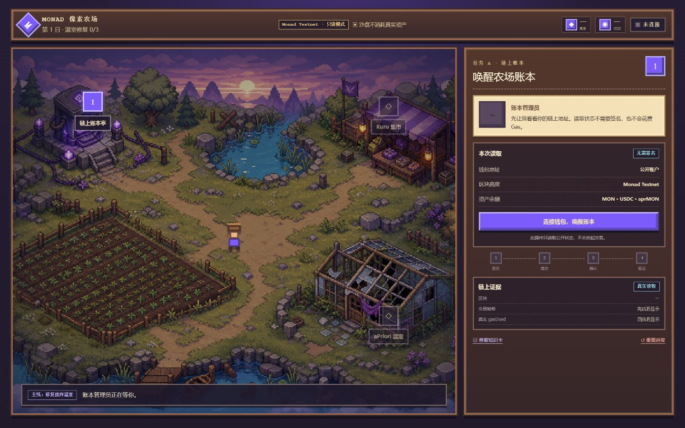
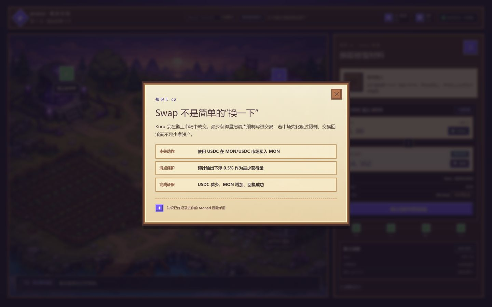
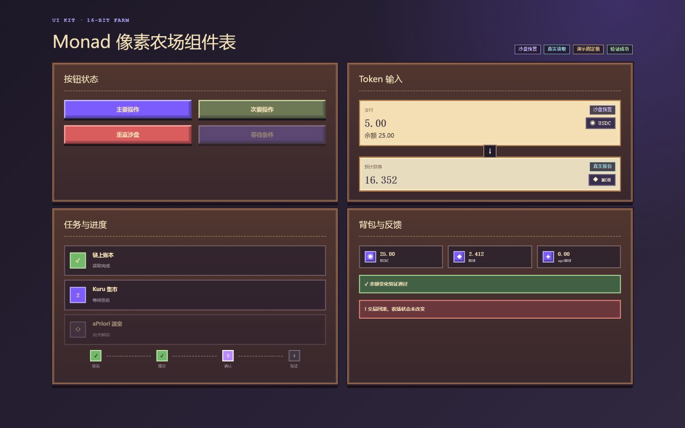
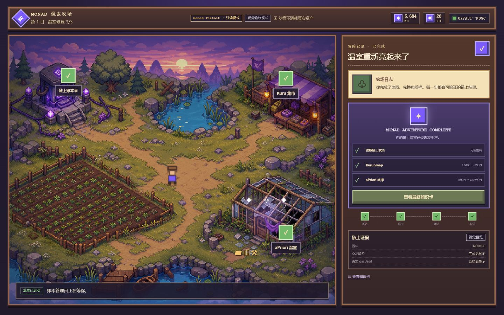

# Monad 像素农场：Web3 游戏化学习平台 PRD

版本：v3.0  
状态：双角色执行版  
日期：2026-07-30  
核心结构：课程种子 → 理论发芽 → 闯关开花 → 验证结果 → 收获成就  
MVP 技术决策：仅保留用户与系统管理员；系统管理员面板只负责平台稳定

> **一句话定义**：用户开启课程时获得一颗知识种子，完成理论学习让种子发芽，完成闯关让种子开花，通过 Agent 提问或结课考试让作物结果，最终收获果实、学习成就和可选 NFT。

<!-- DOCX_BODY -->

## 0. v3.0 核心决策

v3.0 不再以修复温室为主线，也不建设复杂运营体系。产品围绕“知识种子成长”形成一条稳定、清晰、可重复的学习循环。

本版本冻结以下决策：

- 平台只有两个角色：用户、系统管理员。
- 系统管理员只有一个稳定性管理面板，不承担日常课程运营。
- Web3 通识、Monad、智能合约按照难度顺序解锁。
- 用户开启课程时立即获得对应种子。
- 理论完成对应发芽，并获得学习经验。
- 章节闯关成功对应开花。
- Agent 提问或结课考试通过对应结果。
- 用户主动收获后获得果实、平台成就和 NFT 领取资格。
- NFT 铸造为可选动作，失败不影响课程完成和下一课程解锁。
- Agent 是辅助学习与验证功能，不是平台角色。
- 修复温室逻辑暂缓，不进入 MVP。

> **产品公式**：课程是种子，学习是发芽，闯关是开花，验证是结果，收获是成就。

## 1. 产品概述

### 1.1 产品定位

- **品类**：游戏化 Web3 学习平台。
- **首发主题**：Web3 通识、Monad、智能合约。
- **表现形式**：原创像素农场。
- **核心机制**：学习进度驱动作物成长。
- **核心结果**：用户完成课程并形成可回看的学习证明。

### 1.2 用户问题

Web3 新用户通常遇到以下问题：

- 概念分散，不知道应该先学什么。
- 钱包、交易和智能合约之间缺少清晰关系。
- 普通课程缺少即时反馈和持续动力。
- 完成课程后没有能够保存和分享的结果。
- 面对钱包或链上操作时缺乏安全判断能力。

### 1.3 产品价值

用户不只是“看完课程”，而是看到自己的知识种子随着学习过程发芽、开花和结果。每一种作物对应一条知识路线，每次收获代表完成一次完整学习闭环。

### 1.4 对外表达

> **在 Monad 像素农场里种下知识：学习让种子发芽，闯关让它开花，掌握知识后收获属于自己的 Web3 成就。**

## 2. 产品目标与非目标

### 2.1 MVP 目标

- 用户注册后能够立即开启 Web3 通识课程。
- 用户在开启课程时获得课程种子并完成播种。
- 用户完成理论、闯关和最终验证后看到三次成长变化。
- 用户完成一门课程后获得果实和平台成就。
- 用户完成前置课程后自动解锁下一课程。
- Agent 能够解释当前课程、辅助复习并执行标准化提问。
- 系统管理员能够发现并处理平台、Agent、数据和 NFT 服务故障。
- 用户所有关键进度在刷新和重新登录后能够恢复。

### 2.2 MVP 非目标

- 不设置运营角色和运营后台。
- 不提供后台课程编辑器。
- 不做周度作业、作品集和教师批改。
- 不做排行榜、社交关系和多人农场。
- 不做浇水、天气、季节、体力和真实时间生长。
- 不做种子付费购买。
- 不做复杂题型。
- 不恢复修复温室主线。
- 不做 NFT 交易市场和金融收益。
- 不让系统管理员替用户完成课程、考试或钱包签名。

## 3. 用户与角色

### 3.1 用户

用户是平台唯一的前台角色，能够：

- 注册、登录和退出。
- 管理自己的基本资料。
- 开启已解锁课程。
- 获得并种植自己的课程种子。
- 学习理论章节和知识卡。
- 使用 Agent 学习助手。
- 完成章节闯关。
- 选择 Agent 提问或结课考试完成最终验证。
- 收获自己的作物。
- 查看自己的经验、等级、果实、成就和 NFT。
- 连接自己的钱包并主动领取 NFT。

用户只能访问自己的学习、土地、钱包和成就数据。

### 3.2 系统管理员

系统管理员只负责平台稳定，能够：

- 查看各服务运行状态。
- 开启或关闭故障模块。
- 管理异常用户账号。
- 修复学习进度、种子、土地、成就和 NFT 状态不同步。
- 查看 Agent、RPC、数据库和 NFT 服务异常。
- 查看系统日志和管理员操作记录。

系统管理员不负责：

- 日常编辑课程。
- 编写题目。
- 修改标准答案。
- 给普通用户手工发放正常奖励。
- 替用户参加考试。
- 替用户进行 Agent 验证。
- 替用户签署链上交易。

### 3.3 Agent 服务身份

Agent 是系统服务，不是用户角色。Agent 只能读取：

- 已发布课程内容。
- 当前用户所在课程。
- 当前章节。
- 当前用户主动提交的问题。
- 当前验证会话中的标准问题与判定要点。

Agent 不能读取或操作：

- 私钥、助记词和钱包授权。
- 其他用户的学习数据。
- 用户正式考试答案配置。
- 平台奖励发放接口。
- 系统管理员功能。

## 4. 核心学习成长流程

### 4.1 单门课程完整流程

1. 课程满足解锁条件。
2. 用户点击“开启课程”。
3. 系统发放对应课程种子。
4. 用户进入未开荒土地。
5. 用户开荒并种下课程种子。
6. 用户学习全部理论章节。
7. 系统发放学习经验，种子发芽。
8. 用户完成章节闯关。
9. 作物开花，解锁最终验证。
10. 用户选择 Agent 提问或结课考试。
11. 最终验证通过，作物结果。
12. 用户点击收获。
13. 系统发放果实、平台成就和 NFT 领取资格。
14. 系统解锁下一门课程。
15. 用户选择是否连接钱包领取 NFT。

### 4.2 成长阶段映射

| 课程阶段 | 用户动作 | 种子/作物状态 | 用户获得 |
|---|---|---|---|
| 可以开启 | 点击开启课程 | 获得种子 | 课程种子 |
| 开始学习 | 开荒并播种 | 种子入土 | 学习任务 |
| 理论完成 | 完成全部理论章节 | 发芽 | 学习经验 |
| 闯关完成 | 完成章节判断与任务 | 开花 | 闯关记录 |
| 最终验证通过 | Agent 提问或结课考试通过 | 结果 | 收获资格 |
| 课程完成 | 点击收获 | 已收获 | 果实、成就、NFT 资格 |

### 4.3 不允许的状态跳跃

- 未开启课程不能获得种子。
- 未获得种子不能播种。
- 未完成理论不能发芽。
- 未完成闯关不能开花。
- 未完成最终验证不能结果。
- 未结果不能收获。
- 未收获不能解锁下一课程。
- NFT 铸造成功与否不能改变课程完成状态。

## 5. 三条课程路线

### 5.1 解锁顺序

```text
Web3 通识
→ Monad 基础
→ 智能合约
```

| 顺序 | 课程 | 种子 | 默认状态 | 解锁条件 |
|---|---|---|---|---|
| 1 | Web3 通识 | 种子 1 | 可以开启 | 用户完成注册 |
| 2 | Monad 基础 | 种子 2 | 未解锁 | 收获通识课程作物 |
| 3 | 智能合约 | 种子 3 | 未解锁 | 收获 Monad 课程作物 |

### 5.2 Web3 通识课程

**学习目标**：用户理解区块链账户、钱包、地址、交易和基础安全。

建议章节：

1. 区块链是什么。
2. 钱包、账户和地址。
3. 读取、签名和交易。
4. Gas 与交易状态。
5. Token、NFT 和区块浏览器。
6. 私钥、助记词与常见风险。

章节闯关示例：

- 判断公开地址能否被查询。
- 判断哪种信息不能分享。
- 识别读取操作和写入操作。
- 识别危险签名请求。

最终验证重点：

- 用户能够解释地址与私钥的区别。
- 用户能够说明为什么读取余额不需要签名。
- 用户能够说出签名前需要检查的内容。

### 5.3 Monad 基础课程

**学习目标**：用户理解 Monad 网络的基础使用方式，并能读取公开链上状态。

建议章节：

1. Monad 网络与 EVM 基础关系。
2. 网络、RPC 与区块。
3. 钱包网络切换。
4. 区块浏览器与交易查询。
5. Monad 生态应用的基本交互流程。
6. 测试网与真实资产的区别。

章节闯关示例：

- 识别当前网络。
- 找出区块高度。
- 判断测试网资产是否具有真实价值。
- 根据交易状态选择下一步操作。

最终验证重点：

- 用户能够解释网络与钱包账户的关系。
- 用户能够使用区块浏览器查找交易。
- 用户能够区分测试网练习和真实资产操作。

### 5.4 智能合约课程

**学习目标**：用户理解智能合约的状态、读取、写入、ABI、事件和回执。

建议章节：

1. 智能合约是什么。
2. 合约状态与函数。
3. 读取函数与写入函数。
4. ABI 的作用。
5. 交易回执与事件。
6. 合约权限与常见安全风险。

章节闯关示例：

- 判断函数是读取还是写入。
- 按顺序排列模拟、签名、提交、确认和验证。
- 从回执中识别成功或失败。
- 判断陌生合约授权风险。

最终验证重点：

- 用户能够说明读取和写入的区别。
- 用户能够解释交易为什么需要等待确认。
- 用户能够说出 ABI 和回执的用途。

## 6. 课程结构

### 6.1 标准课程组成

每门课程包含：

- 课程名称。
- 学习目标。
- 预计学习时间。
- 先修课程。
- 对应种子和作物。
- 3～6 个理论章节。
- 每章一张知识卡。
- 每章一个简单闯关。
- Agent 提问入口。
- 一个最终 Agent 验证题组。
- 一套结课考试。
- 一个课程成就。
- 一个 NFT 领取资格。

### 6.2 理论章节

每个章节包含：

- 一句章节目标。
- 200～500 字正文。
- 1～3 个关键术语。
- 一个示例。
- 一个风险或注意事项。
- 一张总结知识卡。
- 一个 Agent 提问入口。

章节阅读状态：

```text
未开始
→ 阅读中
→ 已读完
→ 章节闯关完成
```

### 6.3 知识卡

知识卡固定包含：

- 当前概念是什么。
- 为什么需要知道。
- 用户实际会看到什么。
- 哪些操作会改变资产。
- 一个安全检查。

知识卡必须支持：

- 在章节中查看。
- 在 Agent 对话中引用。
- 在错题解释中打开。
- 在个人学习档案中回看。

## 7. 闯关与考试

### 7.1 章节闯关

MVP 题型只保留：

- 判断题。
- 两项选择题。
- 简单步骤排序。
- 风险场景判断。

每个章节设置1～3题，必须全部正确。

答错处理：

- 显示错误原因。
- 推荐对应知识卡。
- 提供“问 Agent”入口。
- 允许立即重新回答。
- 不清空已经完成的章节。

全部章节闯关通过后，作物进入开花状态。

### 7.2 最终验证方式

用户在开花后选择一种方式：

- Agent 标准化提问。
- 结课考试。

通过任意一种方式即可让作物结果。

### 7.3 Agent 标准化提问

Agent 从当前课程的固定题组中选择3道情境问题。

每道问题配置：

- 问题文本。
- 必须包含的知识要点。
- 允许的等价表达。
- 错误或危险表达。
- 第一次提示。
- 第二次提示。
- 通过条件。

判定规则：

- Agent 负责提问、追问和解释。
- 系统根据预设知识要点记录通过结果。
- 单次回答缺少要点时先追问。
- 每题最多提供两次提示。
- 3题全部通过后完成最终验证。
- 对话超时或服务异常时，用户可以切换到结课考试。

### 7.4 结课考试

- 每门课程5～8题。
- 以判断题和简单选择题为主。
- 必须全部正确。
- 答错立即显示解释。
- 允许不限次数重试。
- 不设置排名。
- 不限制用户切换到 Agent 提问。

### 7.5 验证路线标记

| 完成方式 | 用户标记 |
|---|---|
| Agent 提问通过 | 对话学习 |
| 结课考试通过 | 标准考试 |
| 两种方式都通过 | 完全掌握 |

标记只用于学习档案，不影响 NFT 稀缺性和资产价值。

## 8. Agent 学习助手

### 8.1 使用入口

- 理论章节中的“问 Agent”。
- 知识卡中的“换一种方式解释”。
- 闯关答错后的“帮我理解”。
- 最终验证中的“Agent 提问”。

### 8.2 Agent 功能

- 解释当前知识点。
- 使用生活化类比。
- 举例说明钱包和交易。
- 根据错题提供提示。
- 生成不计分练习。
- 推荐复习章节。
- 执行标准化最终提问。

### 8.3 Agent 限制

- 不直接给出正在进行的正式考试答案。
- 不代替用户提交答案。
- 不修改课程、作物和奖励状态。
- 不直接调用 NFT 发放。
- 不代替用户连接钱包和签名。
- 不要求用户提供私钥或助记词。
- 不提供收益承诺、代币价格预测和投资结论。

### 8.4 Agent 故障降级

当 Agent 服务不可用：

- 理论课程继续可用。
- 章节闯关继续可用。
- 最终验证自动提供结课考试。
- 页面显示维护说明。
- 不丢失当前课程和对话前的学习进度。

## 9. 种子、土地与作物

### 9.1 种子获取

用户在课程满足解锁条件后点击“开启课程”，系统立即：

- 创建课程进度。
- 发放对应种子。
- 将种子加入用户背包。
- 解锁一块可使用土地。
- 引导用户前往播种。

同一课程只能正常发放一次种子。

### 9.2 土地状态

```text
未解锁
→ 未开荒
→ 已开荒
→ 空闲
→ 已播种
→ 可以收获
→ 已收获
```

### 9.3 作物状态

```text
无作物
→ 种子入土
→ 发芽
→ 开花
→ 结果
→ 已收获
```

### 9.4 MVP 交互

- 用户选择一块未开荒土地。
- 点击“开荒”。
- 选择当前课程种子。
- 点击“播种”。
- 系统根据学习节点切换成长动画。
- 结果后由用户主动点击“收获”。

MVP 不需要：

- 浇水。
- 施肥。
- 作物属性。
- 时间等待。
- 天气。
- 体力。
- 多次收割。

### 9.5 状态同步

| 学习事件 | 游戏事件 |
|---|---|
| 开启课程 | 发放种子 |
| 用户完成播种 | 创建作物 |
| 理论完成 | 作物发芽 |
| 闯关完成 | 作物开花 |
| 最终验证通过 | 作物结果 |
| 用户点击收获 | 发放成就与 NFT 资格 |

## 10. 经验、等级与成就

### 10.1 学习经验

经验只代表学习进度，不是货币。

| 行为 | EXP |
|---|---:|
| 完成一个理论章节 | 10 |
| 完成章节闯关 | 20 |
| 完成 Agent 最终验证 | 50 |
| 完成结课考试 | 50 |
| 收获课程作物 | 100 |

同一章节和同一验证方式只发放一次经验。

### 10.2 学习等级

MVP 使用四级：

| 等级 | 名称 | 解锁方式 |
|---|---|---|
| Lv.1 | 初来乍到 | 注册完成 |
| Lv.2 | Web3 学徒 | 收获通识作物 |
| Lv.3 | Monad 探索者 | 收获 Monad 作物 |
| Lv.4 | 合约建造师 | 收获智能合约作物 |

### 10.3 平台成就

| 课程 | 成就 |
|---|---|
| Web3 通识 | Web3 初学者 |
| Monad 基础 | Monad 探索者 |
| 智能合约 | 合约建造师 |
| 三门全部完成 | Monad 农场学者 |

平台成就在收获时立即发放，不依赖钱包。

## 11. NFT

### 11.1 NFT 定位

NFT 是课程完成后的可选链上学习证明，不是课程通关条件，不具有收益承诺。

### 11.2 NFT 流程

1. 用户通过最终验证。
2. 作物结果。
3. 用户点击收获。
4. 平台发放成就。
5. 系统生成 NFT 领取资格。
6. 用户选择“领取 NFT”。
7. 用户连接钱包。
8. 页面展示网络、NFT 内容和可能的 Gas。
9. 用户主动确认钱包请求。
10. 系统等待回执并验证结果。
11. NFT 进入个人学习档案。

### 11.3 NFT 规则

- 同一用户、同一课程只生成一次正常领取资格。
- 同一资格只能成功铸造一次。
- NFT 铸造失败不影响课程、经验和成就。
- 用户可以稍后领取。
- 平台不保管用户私钥。
- 系统管理员不能替用户签名。
- 分享页不展示资产价格。

## 12. 场景与信息架构

### 12.1 用户端场景

| 场景 | 功能 |
|---|---|
| 农场首页 | 总进度、课程入口、土地与作物 |
| Monad 知识库 | 课程路线、章节、知识卡 |
| 学习工坊 | Agent、闯关、结课考试 |
| 种子小铺 | 查看已解锁、已获得和已完成种子 |
| 未开荒土地 | 开荒、播种、成长和收获 |
| 成就档案 | 经验、等级、作物、徽章和 NFT |

修复温室场景暂不作为功能入口。

### 12.2 用户端页面

1. 注册/登录页。
2. 农场首页。
3. 课程路线页。
4. 课程详情页。
5. 理论章节页。
6. 知识卡。
7. Agent 对话页或侧栏。
8. 章节闯关页。
9. 最终验证选择页。
10. Agent 最终提问页。
11. 结课考试页。
12. 种子背包与种子小铺。
13. 土地与播种页。
14. 作物成长结果页。
15. 收获与成就页。
16. NFT 领取页。
17. 个人学习档案。

### 12.3 系统管理员页面

1. 管理员登录。
2. 系统状态总览。
3. 用户账号异常。
4. 学习进度异常。
5. Agent 服务状态。
6. 数据库与缓存状态。
7. Monad 与 NFT 服务状态。
8. 系统日志。

## 13. 用户端详细模块

### 13.1 用户与身份

功能：

- 注册。
- 登录。
- 退出。
- 用户名。
- 头像。
- 学习等级。
- 钱包连接与解绑。
- 当前课程。
- 已完成课程。
- 经验与成就。

权限：

- 用户只能查看和编辑自己的资料。
- 用户不能修改自己的经验、等级和课程结果。
- 用户不能访问其他用户数据。

账号注册登录的具体凭证方式必须在开发前单独确定。

### 13.2 课程与知识库

功能：

- 查看课程路线。
- 开启已解锁课程。
- 阅读理论章节。
- 查看知识卡。
- 查看课程进度。
- 进入 Agent 和闯关。

权限：

- 用户只能学习已解锁课程。
- 用户不能修改课程内容。
- 已发布课程内容由版本化内容包提供，不通过管理员面板编辑。

### 13.3 种田

功能：

- 查看种子。
- 开荒。
- 播种。
- 查看成长。
- 收获。

权限：

- 用户只能操作自己的土地和种子。
- 用户不能跳过成长阶段。
- 用户不能重复领取和收获。

### 13.4 成就与 NFT

功能：

- 查看经验。
- 查看等级。
- 查看作物图鉴。
- 查看平台成就。
- 查看 NFT 资格。
- 主动领取 NFT。

权限：

- 用户只能领取自己的资格。
- NFT 请求必须由用户钱包确认。

## 14. 系统管理员面板

### 14.1 面板目标

系统管理员面板只解决三个问题：

1. 平台是否正常。
2. 哪个用户或任务状态出现异常。
3. 管理员如何安全修复并留下记录。

### 14.2 系统状态总览

展示：

- Web 服务状态。
- 数据库状态。
- 登录服务状态。
- Agent 服务状态。
- Monad RPC 状态。
- NFT 铸造服务状态。
- 最近错误数量。
- 最近失败任务数量。

操作：

- 开启维护模式。
- 暂停故障模块。
- 恢复已修复模块。
- 查看错误详情。

### 14.3 用户账号异常

展示：

- 用户标识。
- 账号状态。
- 注册时间。
- 最近登录时间。
- 当前课程。
- 是否存在异常状态。

操作：

- 禁用异常账号。
- 恢复账号。
- 强制退出异常会话。
- 查看脱敏学习状态。

### 14.4 学习进度异常

展示：

- 课程状态。
- 种子状态。
- 土地状态。
- 作物状态。
- 闯关状态。
- 最终验证状态。
- 成就状态。
- NFT 资格状态。

允许修复：

- 课程完成但种子未发放。
- 理论完成但作物未发芽。
- 闯关完成但作物未开花。
- 验证通过但作物未结果。
- 已收获但成就未发放。
- NFT 已铸造但平台状态未更新。

修复要求：

- 必须填写原因。
- 必须记录操作人。
- 必须记录修改前后状态。
- 不允许修改正常考试答案。
- 不允许伪造钱包签名和交易哈希。

### 14.5 Agent 服务

展示：

- 服务在线状态。
- 请求成功率。
- 平均响应时间。
- 请求失败数量。
- 被安全策略拦截的请求数量。
- 最终验证异常数量。

操作：

- 开启或关闭 Agent。
- 切换维护状态。
- 清理异常会话。
- 查看脱敏错误日志。

### 14.6 Monad 与 NFT 服务

展示：

- RPC 状态。
- NFT 服务状态。
- 待确认交易。
- 成功交易。
- 失败交易。
- 回执验证失败记录。

操作：

- 暂停 NFT 领取入口。
- 重新读取交易回执。
- 修复平台 NFT 状态。
- 恢复 NFT 服务入口。

管理员不能：

- 替用户签名。
- 访问私钥或助记词。
- 把失败交易改成链上成功。

### 14.7 系统日志

记录：

- 管理员登录。
- 维护模式切换。
- 模块暂停与恢复。
- 用户禁用与恢复。
- 学习进度修复。
- 种子、作物和成就修复。
- Agent 服务操作。
- NFT 状态修复。
- 操作时间、操作人、原因和前后状态。

## 15. 权限矩阵

| 功能 | 用户 | 系统管理员 |
|---|---|---|
| 注册、登录 | 操作自己的账号 | 查看状态、处理异常 |
| 编辑资料 | 编辑自己的资料 | 不代替用户日常编辑 |
| 课程学习 | 学习自己的课程 | 查看异常状态 |
| 使用 Agent | 使用自己的学习助手 | 管理服务稳定 |
| 闯关与考试 | 提交自己的答案 | 不修改正常答案 |
| 种子获取 | 系统按规则发放 | 修复漏发异常 |
| 土地与作物 | 操作自己的土地 | 修复不同步 |
| 经验与成就 | 查看自己的结果 | 修复计算和发放异常 |
| NFT | 使用自己的钱包领取 | 监控和修复平台状态 |
| 钱包签名 | 只能用户本人签名 | 无权限 |
| 系统配置 | 无权限 | 管理稳定性配置 |
| 系统日志 | 无权限 | 查看 |

## 16. 状态机

### 16.1 课程状态

```text
未解锁
→ 可以开启
→ 学习中
→ 理论完成
→ 闯关完成
→ 最终验证通过
→ 可以收获
→ 已完成
```

### 16.2 Agent 验证状态

```text
未开始
→ 提问中
→ 等待回答
→ 需要补充
→ 单题通过
→ 全部通过
→ 服务异常
→ 已切换考试
```

### 16.3 NFT 状态

```text
无资格
→ 可以领取
→ 等待钱包
→ 等待签名
→ 已提交
→ 确认中
→ 铸造成功
→ 铸造失败
```

### 16.4 幂等规则

- 同一课程种子只正常发放一次。
- 同一章节经验只正常发放一次。
- 同一闯关完成事件只触发一次开花。
- 同一最终验证只触发一次结果。
- 同一作物只正常收获一次。
- 同一课程成就只正常发放一次。
- 同一 NFT 资格只能成功铸造一次。

## 17. 数据与持久化

### 17.1 逻辑对象

| 对象 | 核心内容 |
|---|---|
| 用户账户 | 用户标识、资料、账号状态 |
| 钱包关联 | 地址、网络、关联时间 |
| 课程 | 课程版本、顺序、先修关系 |
| 章节进度 | 阅读、闯关和完成时间 |
| 课程进度 | 当前阶段、验证方式和完成时间 |
| 种子 | 类型、所属课程、发放状态 |
| 土地 | 解锁、开荒和使用状态 |
| 作物 | 成长阶段、所属种子和收获状态 |
| 经验记录 | 来源、数量和发放时间 |
| 成就 | 类型、课程和发放时间 |
| NFT 资格 | 课程、钱包、领取状态 |
| Agent 会话 | 课程、问题、提示和结果 |
| 管理员日志 | 操作人、原因和前后状态 |

### 17.2 数据原则

- 学习进度、种子和作物必须可以恢复。
- 钱包不是平台账号的唯一身份。
- 不保存私钥、助记词和签名原文。
- Agent 对话只保存完成学习所需内容。
- 管理员修复必须具备审计记录。
- 链上 NFT 状态以真实回执为依据。

## 18. UI 与视觉需求

### 18.1 主地图

保留：

- Monad 知识库。
- 学习工坊。
- 种子小铺。
- 未开荒土地。
- 玩家成就入口。

暂不开放：

- 修复温室任务。
- 自由经营区域。

### 18.2 关键成长画面

必须具备：

1. 课程开启与种子进入背包。
2. 选择土地并播种。
3. 理论完成后的发芽。
4. 闯关完成后的开花。
5. 最终验证后的结果。
6. 点击收获。
7. 成就和 NFT 资格展示。

### 18.3 状态表达

| 状态 | 主色 | 辅助表达 |
|---|---|---|
| 已解锁 | 紫色 | 发光边框和文字 |
| 学习中 | 蓝色 | 进度和书本图标 |
| 发芽/开花 | 绿色 | 植物动画 |
| 可以收获 | 金色 | 果实闪光和按钮 |
| 失败 | 红色 | 错误说明和恢复动作 |
| 维护 | 橙色 | 工具图标和维护文案 |

## 19. 错误与恢复

### 19.1 用户端错误提示

必须说明：

1. 发生了什么。
2. 已完成进度是否保留。
3. 用户下一步可以做什么。

### 19.2 关键异常

| 异常 | 用户结果 | 恢复方式 |
|---|---|---|
| 登录失败 | 不进入账户 | 重试或查看提示 |
| 课程加载失败 | 保留已有进度 | 重新加载 |
| Agent 不可用 | 课程继续可用 | 使用结课考试 |
| 经验漏发 | 不影响课程状态 | 管理员修复 |
| 种子漏发 | 无法播种 | 管理员重新执行发放 |
| 作物状态不同步 | 显示异常提示 | 管理员修复 |
| NFT 签名拒绝 | 成就不受影响 | 稍后领取 |
| NFT 交易失败 | 保留领取资格 | 重试 |
| RPC 不可用 | NFT 暂停 | 稍后重试 |

## 20. 安全与隐私

- 平台不保存私钥和助记词。
- 用户正式考试期间 Agent 不直接提供答案。
- Agent 不提供投资建议和收益承诺。
- NFT 页面明确显示网络、操作内容和可能的 Gas。
- 用户钱包签名只能由用户主动发起。
- 系统管理员不能伪造链上成功。
- 用户数据默认只对本人可见。
- 管理员界面使用脱敏钱包地址。
- 管理员操作全部记录。

## 21. 指标

### 21.1 北极星指标

**成功收获课程作物的用户数**：完成理论、闯关、最终验证并点击收获的用户数。

### 21.2 核心漏斗

```text
注册
→ 开启课程
→ 获得种子
→ 完成播种
→ 理论完成/发芽
→ 闯关完成/开花
→ 最终验证/结果
→ 收获
→ 查看成就
→ 领取 NFT
```

### 21.3 MVP 内部目标

| 指标 | 目标 |
|---|---:|
| 注册后开启通识课程 | 不低于 85% |
| 开启课程后完成播种 | 不低于 95% |
| 理论完成率 | 不低于 80% |
| 闯关完成率 | 不低于 75% |
| 最终验证通过率 | 不低于 70% |
| 结果后完成收获 | 不低于 95% |
| 主流程死路 | 0 |
| 十次连续演示成功 | 10/10 |

## 22. MVP 范围

### 22.1 P0 必须完成

- 用户注册、登录和个人资料。
- Web3 通识、Monad、智能合约三门课程。
- 课程顺序解锁。
- 开启课程获得种子。
- 未开荒土地、开荒和播种。
- 理论章节和知识卡。
- 简单章节闯关。
- Agent 学习问答。
- Agent 标准化最终提问。
- 结课考试。
- 发芽、开花、结果和收获。
- 学习经验和等级。
- 平台成就。
- NFT 领取资格。
- 用户学习档案。
- 系统管理员稳定性面板。
- 状态恢复和管理员审计日志。

### 22.2 P1

- NFT 真实铸造。
- Monad 公开读取实践。
- 智能合约测试网读取。
- 分享卡。
- 更多成就动画。

### 22.3 暂缓

- 运营角色和运营后台。
- 后台课程编辑器。
- 周度作业。
- 作品集。
- 排行榜。
- 多人农场。
- 完整经营系统。
- 修复温室。
- NFT 市场。

## 23. 功能验收

### 23.1 课程与种子

- [ ] 注册后通识课程为可以开启。
- [ ] 点击开启课程后只发放一次种子。
- [ ] 未完成前置课程时后续课程不能开启。
- [ ] 种子必须由用户主动播种。
- [ ] 刷新后种子和土地状态保留。

### 23.2 成长

- [ ] 理论全部完成后发芽并发放经验。
- [ ] 章节闯关全部完成后开花。
- [ ] Agent 或考试通过后结果。
- [ ] 未结果时不能收获。
- [ ] 收获后发放果实、成就和 NFT 资格。
- [ ] 收获后解锁下一课程。

### 23.3 Agent 与考试

- [ ] Agent 可以解释当前课程。
- [ ] 正式考试进行中 Agent 不给出答案。
- [ ] Agent 故障时可以切换结课考试。
- [ ] Agent 标准化提问使用预设知识要点判定。
- [ ] 结课考试必须全部正确。
- [ ] 重试不清空理论和闯关进度。

### 23.4 NFT

- [ ] NFT 领取为用户主动动作。
- [ ] NFT 失败不影响课程和成就。
- [ ] 同一资格不能成功领取两次。
- [ ] 系统管理员不能替用户签名。
- [ ] 链上成功以回执验证为准。

### 23.5 系统管理员

- [ ] 面板显示关键服务状态。
- [ ] 管理员可以暂停 Agent 和 NFT 故障入口。
- [ ] 管理员可以修复状态不同步。
- [ ] 每次修复必须填写原因。
- [ ] 修复前后状态进入日志。
- [ ] 管理员不能修改正常考试答案。

## 24. 非功能需求

### 24.1 性能

- 页面主要操作点击后100毫秒内显示反馈。
- 课程页面正常网络下2.5秒内可交互。
- Agent 请求必须有等待、超时和重试状态。
- 管理员状态面板不得无限加载。

### 24.2 可用性

- Agent 故障不阻断结课。
- NFT 故障不阻断课程。
- 刷新不丢失学习进度。
- 同一完成事件重复提交不重复发放奖励。

### 24.3 可访问性

- 按钮支持键盘操作。
- 状态不只使用颜色。
- 作物动画提供文字状态。
- 对话框具备标题、关闭和焦点管理。
- 支持减少动态效果。

## 25. 开发顺序

1. 用户注册登录与课程状态。
2. Web3 通识课程壳和种子发放。
3. 土地、播种与发芽。
4. 章节闯关与开花。
5. 结课考试与结果。
6. 收获、经验和成就。
7. Monad 与智能合约课程。
8. Agent 学习助手和标准化提问。
9. 系统管理员稳定性面板。
10. NFT 资格和可选铸造。
11. 异常恢复和连续演示。

## 26. v2.0 到 v3.0 的变化

| 领域 | v2.0 | v3.0 |
|---|---|---|
| 主线 | 播种后修复温室 | 课程种子持续成长 |
| 种子获取 | 课程路线中的奖励 | 开启课程立即获得 |
| 理论学习 | 推动温室与作物 | 明确对应发芽和经验 |
| 闯关 | 课程中的一个步骤 | 明确对应开花 |
| 最终验证 | 以学习完成为主 | Agent 提问或考试二选一 |
| 收获 | 修复温室后的终幕 | 每门课程固定结束动作 |
| 角色 | 多个内容与技术角色 | 只有用户和系统管理员 |
| 管理后台 | 包含运营能力 | 只管理平台稳定 |
| NFT | 可选增强 | 收获后生成资格，仍为可选领取 |

## 附录 A：现有视觉参考

现有页面只作为像素风格、地图和组件参考。v3.0 需要重新设计课程种子、播种、发芽、开花、结果和收获状态。









## 附录 B：开发前必须确认

- [ ] 注册登录使用的具体账号方式。
- [ ] 三种种子和三种作物的名称与美术。
- [ ] 三门课程的最终章节数量。
- [ ] 每门课程 Agent 标准提问题组。
- [ ] 每门课程结课考试题数。
- [ ] NFT 是否进入 MVP 真实铸造。
- [ ] NFT 的网络、合约和是否可转让。
- [ ] 系统管理员登录与安全方式。
- [ ] 管理员能够执行的状态修复范围。

