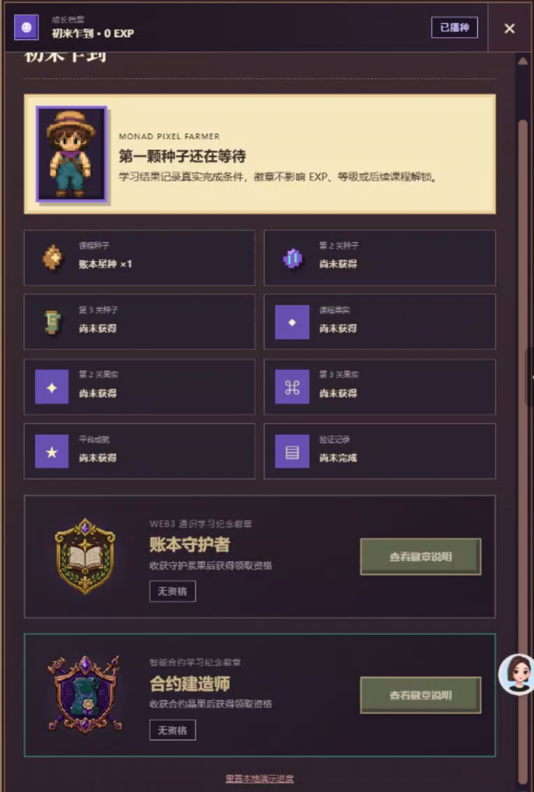

# UI 优化 v1\.0

### **为什么观感奇怪：**

1. **三种风格的权重几乎相同，没有真正的视觉中心。**

**左侧**场景是柔和、自然、有生活感的像素农场，有探索和养成游戏的氛围。

但**外层** UI （画面顶、底部）却是： 深紫黑背景、金色双描边、大量矩形边框； 类似老式 MMORPG、卡牌游戏或 Web3 数据面板。

**右侧**任务栏又像一套 SaaS 后台管理系统。

正常情况下，页面视觉中心应该是：当前角色、当前土地、当前要完成的任务。

2. **边框被当成了主要的分区手段**

页面几乎每个区域都有：

- 外边框

- 内边框

- 金色描边

- 紫色描边

- 卡片边框

- 卡片内部的小卡片边框

尤其顶部、底部和右侧面板，形成了三块厚重的“铁框”，把中间的像素世界夹住。

更现代的设计会更多**依靠留白、明暗、层级和半透明背景**来区分区域。

3. **配色没有形成清晰的功能规则**

当前存在很多相近但不统一的颜色：

- 深棕、紫黑、灰紫、亮紫、金色、米黄色、墨绿色

紫色本应是 Monad 品牌色，但这里同时承担了导航选中、图标背景、地图标记、任务关键字、等级状态、装饰描边。

因此紫色失去了“重点提示”的作用。

目前颜色更多是装饰色，而不是信息语言。

**更合理的规则**可以是：

- 紫色：当前任务、可交互对象

- 金色：稀有奖励、成就

- 绿色：已完成

- 灰色：未解锁

- 红色：风险或失败

4. **右侧任务面板缺乏阅读节奏**

右侧面板同时放了：

- 当前身份、人物卡、钥匙收集情况、学习奖励、两种徽章、查看徽章按钮、底部更多内容

每个模块都被做成同样大小、同样深色、同样描边的矩形。

为了更好地引导用户完成一次游戏行为，可以改成重点展示“当前目标、任务进度、完成奖励”

> 为了更好引导用户完成一次游戏行为，优化 xx 面板的信息展示，呈现清晰的阅读节奏。 使用合理的颜色使用规则，避免把边框当成主要的分区手段。非重点内容可以收进二级页面，不需要同时展开。让画面拥有更多留白。
>
>

### **优化建议：**

**底部导航取消厚重双边框，改为轻量半透明浮动栏。**

**地图（对农场进行交互时）只高亮一个当前交互点，其余地点降低亮度或暂时隐藏标签。**

配色效果对比：

配色结论：以低饱和、偏暖的深棕色为基底色，紫色只作为“功能高亮色”

**总原则**

- **右侧面板背景**：深棕偏黑，稳重、可承载信息

- **底部导航背景**：深棕半透明，更轻、更漂浮

- **紫色**：仅用于按钮、选中态、进度焦点、交互提示

- **金色/暖黄**：用于奖励、EXP、种子等奖励类信息

- **选中态：**发光边缘轻微即可，不要太 neon
